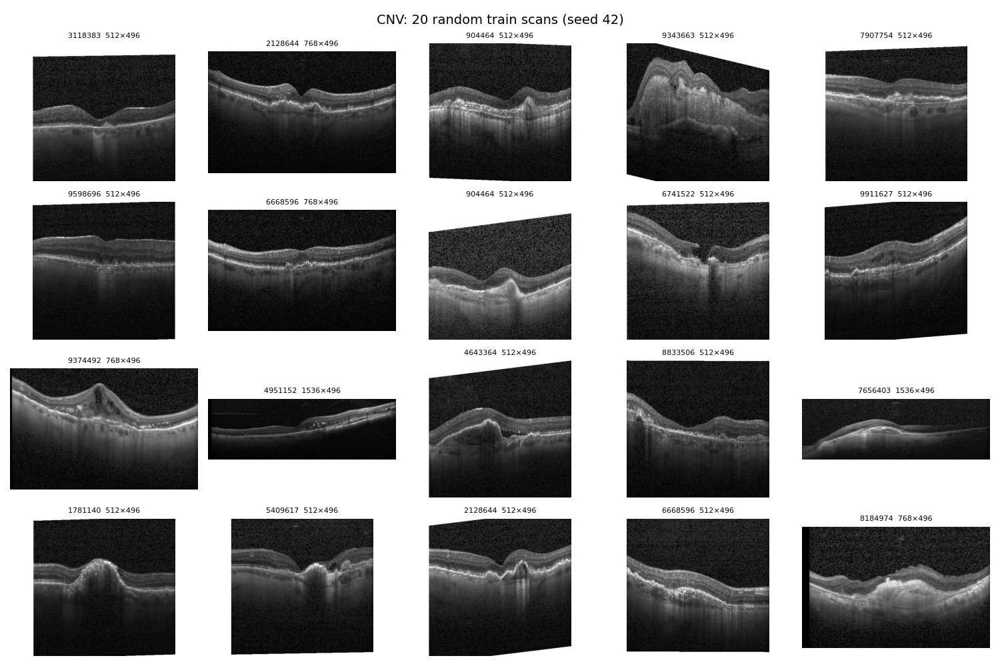
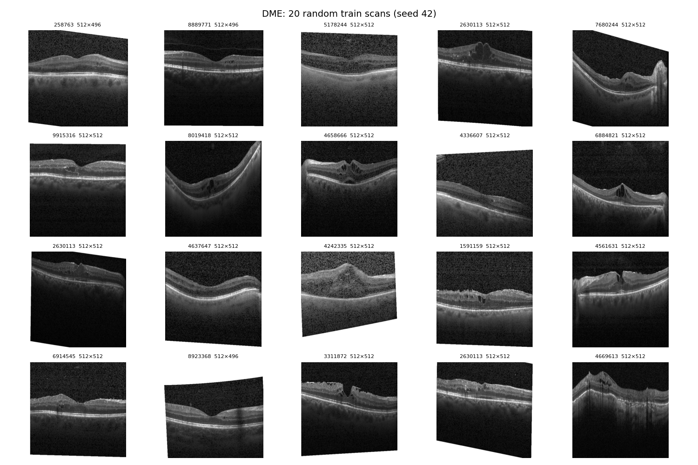
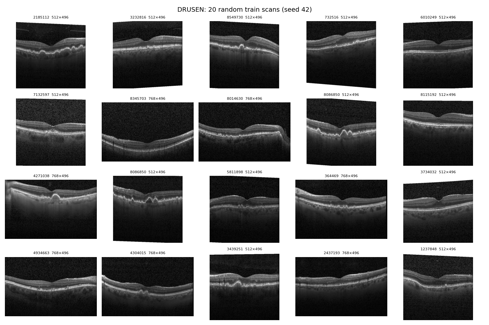
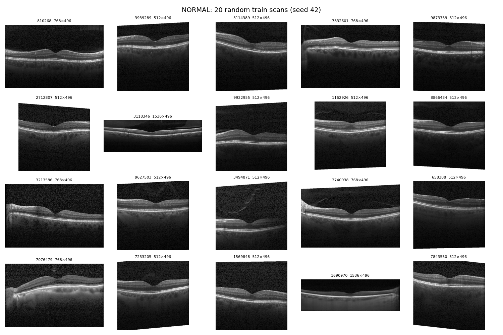
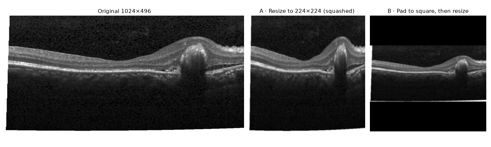
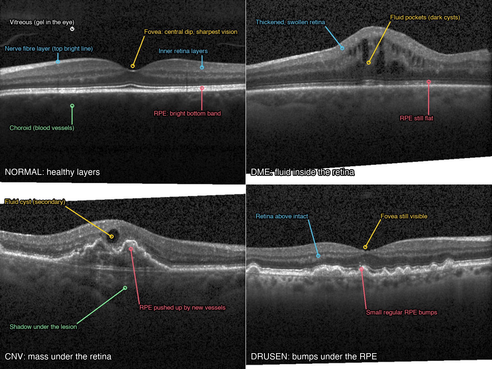
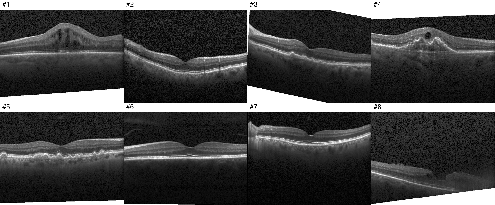
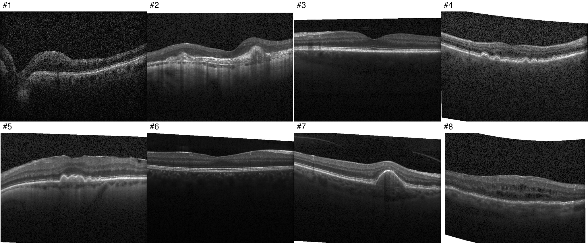
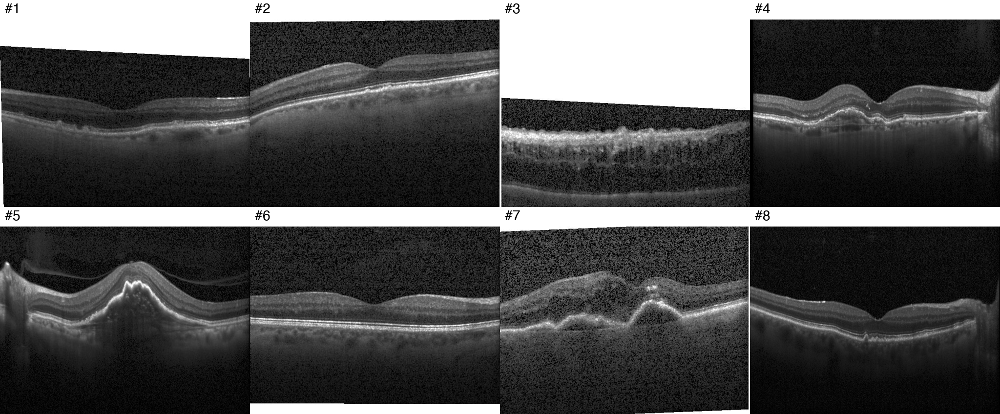

# Notes

**Code layout rule:** real code lives in `.py` files under `src/`. The notebook only clones the repo and calls those files.

## Daily log

One entry a day: what I tried, what broke, what I learned. Newest first.

<b>Sun 25 Oct 2026</b>

- Started Step 4 on the `step4-pipeline` branch.
- Loaded one scan with `decode_image`: `uint8`, 1 channel (grayscale), 496×1024.
- Experiment 1: resize straight to 224×224 vs pad to a square first. Only matters for the wide scans (~38%): resize squashes 1536×496 to a third of its width, padding leaves only 32% of the image as retina.
- Found that **all 8,659 scans at 512×512 are DME** (about 75% of DME scans), probably a different scanner or clinic. Possible shortcut: the model could learn the scanner instead of the fluid. Table: `results/step4_size_by_class.csv`. Check with Grad-CAM in Step 9.
- Kaggle dataset usability score 5.0 → 8.13 (description, tags, sources, cover image).

<b>Sat 24 Oct 2026</b>

- Moved Step 2 to a Kaggle notebook (`zyanislam/oct-calibration`).
- Built an index table (path, split, class, patient, width, height): 0 malformed names, 0 class mismatches, 0 unreadable files.
- Found the Kaggle `kermany2018` copy is the older v2 (84,484 images, stored twice), so I uploaded my local Mendeley v3 copy as the private dataset `zyanislam/kermany-retinal-oct-v3`.
- Reran the index on v3: 109,309 images (108,309 train, 1,000 test), all checks 0.
- Image sizes vary (8 different sizes, see `results/step2_image_sizes.csv`).
- Patients: 4,785 train, 635 test, 0 in both; 787 span more than one class.
- Saved a 20-scan grid per class.
- Step 3: wrote `src/data.py`; the patient split on Kaggle didn't match my Mac.
- Traced it to scikit-learn versions changing `StratifiedGroupKFold`'s shuffle (Kaggle val was 42.5% CNV vs 34.4% in train).
- Fixed with `shuffle=False` and a fold number: identical split on 3 versions.
- Reran on Kaggle with `fold=0`: same 97,479 / 10,830 / 1,000 split, identical row by row to my Mac.
- Saved `splits/oct_split_fold0.csv` and `notebooks/02_patient_split.ipynb`.
- Wrote down why splitting by image would inflate accuracy (Step 3 "done when").

<b>Fri 23 Oct 2026</b>

- Added the build guide + roadmap to `docs/`, a `.gitignore` (runs/, CellData/, kaggle.json) and this file.
- Counted images per class (train is very imbalanced: NORMAL 51k vs DRUSEN 8.6k; test is 250 each).
- Labelling practice: Round 1 3/8 → Round 2 6/8 → Round 3 8/8.
- Learned to check the RPE line first; CNV was my weak class, now drusen vs CNV is.
- Round 3 was drusen/CNV heavy and I got all 8: "smooth & sharp vs fuzzy & broken" works.

<b>Thu 22 Oct 2026</b>

- Created the `oct-calibration` repo, Colab notebook (T4) and Kaggle token (Step 1).
- Downloaded Kermany OCT2017 (Step 2).

## Steps

<strong>Step 1 · Workspace</strong>

- Public GitHub repo `zyanislam/oct-calibration` with `src/`, `notebooks/`, `runs/` (gitignored) and this file.
- Work runs in a Kaggle notebook (`zyanislam/oct-calibration`) that clones the repo and calls `src/`. Colab was the first plan; Kaggle won because the data can be attached and the GPU quota is larger.
- Kaggle API token set up locally so notebooks and outputs can be pulled into the repo.
- Code layout rule (top of this file): real code in `src/`, notebooks stay thin.
- From Step 4 on: one branch per step (`stepN-name`), merged to `main` with a pull request.

<strong>Step 2 · Data</strong>

Kermany OCT2017, local copy in `CellData/OCT/` (gitignored).

**Dataset version: Mendeley v3** ([doi:10.17632/rscbjbr9sj.3](https://data.mendeley.com/datasets/rscbjbr9sj/3)), the release used in Kermany et al. 2018 (*Cell*). On Kaggle I use my private copy `zyanislam/kermany-retinal-oct-v3` ("Kermany Retinal OCT (Mendeley v3)"), not `paultimothymooney/kermany2018`. That one is the older v2 (Mar 2018): 83,484 train with only 26,315 NORMAL, and 968 test (242 per class). It also contains the whole dataset twice (`OCT2017 /` and `oct2017/OCT2017 /`, with a trailing space in the folder name).

| Class  | Train  | Test |
|--------|-------:|-----:|
| CNV    | 37,205 | 250  |
| DME    | 11,348 | 250  |
| DRUSEN |  8,616 | 250  |
| NORMAL | 51,140 | 250  |

Largest / smallest train class ratio: 

51,140 : 8,616 = 5.935 : 1

- For 1 sample of DRUSEN, there are almost 6 samples from the NORMAL class.

### Patients (v3, from the Kaggle index)

| Split | Unique patients | CNV | DME | DRUSEN | NORMAL |
|-------|----------------:|----:|----:|-------:|-------:|
| train | 4,785 | 791 | 709 | 713 | 3,434 |
| test  |   635 | 178 | 167 | 169 |   171 |

- **Patients in both train and test: 0.** The official v3 test set is already patient-disjoint, so Step 3 removes no one from training (still keep the assert).
- **787 patients have scans in more than one class**, so the Step 3 split must group on patient only, never patient + class.
- Train scans per patient: min 1, median 10, max 813. A few patients contribute hundreds of scans, so the same patient shows up several times in a random sample (e.g. 904464 and 6668596 twice in the CNV grid).
- Image sizes: 8 different sizes. Most are 512×496 (58,037), 768×496 (29,749), 1536×496 (11,512), 512×512 (8,659) and 1024×496 (1,329), plus a few odd ones (384×496, 642×277, 900×455). Not all are 496 px tall, so resizing in Step 4 must handle both the width and the height. Full table: `results/step2_image_sizes.csv`.

### Sample grids (20 random train scans per class, seed 42)

What each class looks like:

- CNV: RPE lifted into one big irregular hump with a dark shadow below.
- DME: It has a few dark fluid pockets inside the swollen retina.
- DRUSEN: It contains a row of small, regular bumps on the RPE. The retina above is intact and the fovea is still visible.
- NORMAL: no dark pockets or bumps present insight. Smooth RPE with a clean dip in the center.

<strong>Step 3 · Patient split</strong>

Code: `src/data.py` (`build_index`, `patient_split`, `check_no_leak`). Split saved as `splits/oct_split_fold0.csv` (`path, label, patient, split`); every later step reads this file.

- Official train → train/val by patient with `StratifiedGroupKFold` (10 groups, group 0 = val). The official test set is unchanged.
- Train patients also in test: 0 removed. The `check_no_leak` assert passes.

| Split | Scans | Patients | CNV | DME | DRUSEN | NORMAL |
|-------|------:|---------:|----:|----:|-------:|-------:|
| train | 97,479 | 4,303 | 34.4% | 10.5% | 8.0% | 47.2% |
| val   | 10,830 |   482 | 34.4% | 10.5% | 8.0% | 47.2% |
| test  |  1,000 |   635 | 25% | 25% | 25% | 25% |

### Finding: a fixed seed was not enough for a reproducible split

My first split used `StratifiedGroupKFold(shuffle=True, random_state=42)`. On Kaggle it produced a different validation set from the same code on my Mac, because Kaggle has an older scikit-learn (1.6/1.7 reproduce it exactly; 1.9 differs). The Kaggle split was also badly balanced:

| Val share | Train | Shuffled val (Kaggle) | Fixed val |
|-----------|------:|----------------------:|----------:|
| CNV    | 34.4% | **42.5%** | 34.4% |
| DME    | 10.5% |  8.0% | 10.5% |
| DRUSEN |  8.0% |  **6.6%** |  8.0% |
| NORMAL | 47.2% | 42.9% | 47.2% |

Only 44 of the 473 shuffled-val patients are also in the fixed val set. Fix: `shuffle=False`, choosing the val group with `fold=0` instead of a seed. Tested on scikit-learn 1.6.1, 1.7.2 and 1.9.1: identical split. Full numbers: `results/step3_split_comparison.csv`.

**Lesson:** the seed fixes randomness *inside* a library version, not *across* versions. Save the split as a file and have every step read it, instead of recomputing it.

**Why splitting by image would inflate accuracy:**
If we split by image, the same patient's scans can appear in both the training and validation, as the model has seen the answers during training, it will recognise the eye it already knows, as the scans are nearly identical, recall that eye's label and get it right even though it never learned what each class looks like. Thus the score will look better than it really is but will struggle when new scans of new patients will be given. If the patient repeats, the near identical scans will be an easy find for the model as it already knows the eye, retina and the day the scans were taken. Inflated Accuracy means the model will do worse on new patients.

<strong>Step 4 · Data pipeline</strong> (in progress, branch <code>step4-pipeline</code>)

Goal: train / val / test DataLoaders that read `splits/oct_split_fold0.csv` and load a batch in under a second.

### First scan

`decode_image("test/CNV/CNV-1032178-1.jpeg")` → `torch.uint8`, shape `[1, 496, 1024]`: one channel (grayscale), values 0–255. Needs copying to 3 channels for the pretrained ResNet, and converting to float before `Normalize`.

### Experiment 1 · Resize vs pad to square

| Size | Share of scans | Resize: horizontal squash | Pad: share of image that is retina |
|------|---------------:|--------------------------:|-----------------------------------:|
| 512×496 | 53% | 0.97 | 97% |
| 768×496 | 27% | 0.65 | 65% |
| 1536×496 | 11% | 0.32 | 32% |
| 512×512 | 8% | 1.00 | 100% |
| 1024×496 | 1% | 0.48 | 48% |

The choice barely matters for 61% of scans and matters a lot for the wide ones.

### Finding · Every 512×512 scan is DME

All 8,659 scans at 512×512 are DME, about 75% of DME scans (`results/step4_size_by_class.csv`). They probably come from a different scanner or clinic, so the model could learn the scanner instead of the fluid. Padding would make this worse (512×512 scans would be the only ones with no black bars). Check with Grad-CAM in Step 9, and report DME results for 512×512 and other sizes separately.

### Decisions (write these yourself)

- **Resize strategy:** plain resize to 224x224. It won't create a giveaway for DME, will keep the details where they matter and match the already published work making them comparable to theirs. The only cost: wide scans are squashed; keep-aspect resizing is a possible later experiment.
- **Grayscale to 3 channels:** <!-- where in the transform, and why -->
- **Augmentation values:** <!-- rotation, flip, crop, jitter; why no vertical flip -->

<strong>Labelling practice</strong>

Can I tell the classes apart by eye? 2 random scans per class, shuffled, from `runs/quiz/quiz.png`.
Write my guess before checking `runs/quiz/answers.json`.

Anatomy reference (normal, DME, CNV, drusen with layers labelled):

### Round 1 · Fri 23 Oct 2026

| Scan | My guess | Why (what I saw) | Actual | Right? |
|-----:|----------|------------------|--------|:------:|
| 1 | DME | | DME | ✓ |
| 2 | (skipped) | | DRUSEN | – |
| 3 | DRUSEN | | CNV | ✗ |
| 4 | DME | | CNV | ✗ |
| 5 | DRUSEN | | DRUSEN | ✓ |
| 6 | NORMAL | | NORMAL | ✓ |
| 7 | (skipped) | | NORMAL | – |
| 8 | (skipped) | | DME | – |

Score: 3/8 (3/5 attempted)

Lessons:
- CNV vs DME: DME = many dark fluid pockets *inside* the retina (#1). CNV = the bright bottom layer (RPE) is lifted or broken by a mass *under* the retina, fluid on top is secondary (#4: one cyst, but the RPE below is humped up).
- CNV vs DRUSEN: drusen are small, regular bumps of the RPE with the retina above intact (#5). An irregular, larger RPE elevation with tissue/fluid around it is CNV (#3).
- NORMAL: smooth layers + clean foveal dip (#6, #7). The tilt/curve of the image doesn't matter.
- #2 is labelled DRUSEN but looks almost normal to me. Kermany labels are image-level and can be noisy; remember this for Step 7–8 (confident "mistakes" may be label errors).
- #8 (DME) is low quality and cropped: real data has bad scans too.

### Round 2 · Fri 23 Oct 2026

From `runs/quiz/round2/quiz.png`. Tip: check the RPE line first.

| Scan | My guess | Why (what I saw) | Actual | Right? |
|-----:|----------|------------------|--------|:------:|
| 1 | DME | | DME | ✓ |
| 2 | DRUSEN | | CNV | ✗ |
| 3 | NORMAL | | NORMAL | ✓ |
| 4 | DRUSEN | | DRUSEN | ✓ |
| 5 | CNV | | DRUSEN | ✗ |
| 6 | NORMAL | | NORMAL | ✓ |
| 7 | CNV | | CNV | ✓ |
| 8 | DME | | DME | ✓ |

Score: 6/8 (up from 3/8). Only error: swapped #2 and #5 (drusen vs CNV).

Lessons:
- #5 is DRUSEN even though the bumps are big and clustered: they are smooth, dome-shaped RPE elevations, the layers above follow them cleanly, and there's no fuzzy tissue or fluid. Size alone doesn't make it CNV.
- #2 is CNV: the RPE band is broken and messy (bright, fuzzy, ill-defined material under the retina) with the retina distorted above. Irregular and blurred, not smooth domes.
- #7: a single large, smooth dome is a pigment epithelial detachment (PED); in this dataset it was labelled CNV.
- #1 is DME but the scan is off-centre (the big dip on the left is the optic disc, not the fovea).
- Drusen vs CNV is my weak spot now. Next round: look for *smooth & sharp* (drusen) vs *fuzzy, broken, with fluid* (CNV).

### Round 3 · Fri 23 Oct 2026

From `runs/quiz/round3/quiz.png`. Weighted toward drusen vs CNV (not 2 per class). Smooth & sharp domes = drusen; fuzzy, broken RPE, fluid = CNV.

| Scan | My guess | Why (what I saw) | Actual | Right? |
|-----:|----------|------------------|--------|:------:|
| 1 | DRUSEN | | DRUSEN | ✓ |
| 2 | DRUSEN | | DRUSEN | ✓ |
| 3 | DME | | DME | ✓ |
| 4 | CNV | | CNV | ✓ |
| 5 | CNV | | CNV | ✓ |
| 6 | NORMAL | | NORMAL | ✓ |
| 7 | CNV | | CNV | ✓ |
| 8 | DRUSEN | | DRUSEN | ✓ |

Score: 8/8 (3/8 → 6/8 → 8/8). Drusen vs CNV sorted on the drusen/CNV-heavy round.

