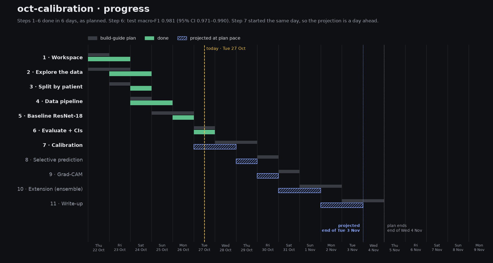
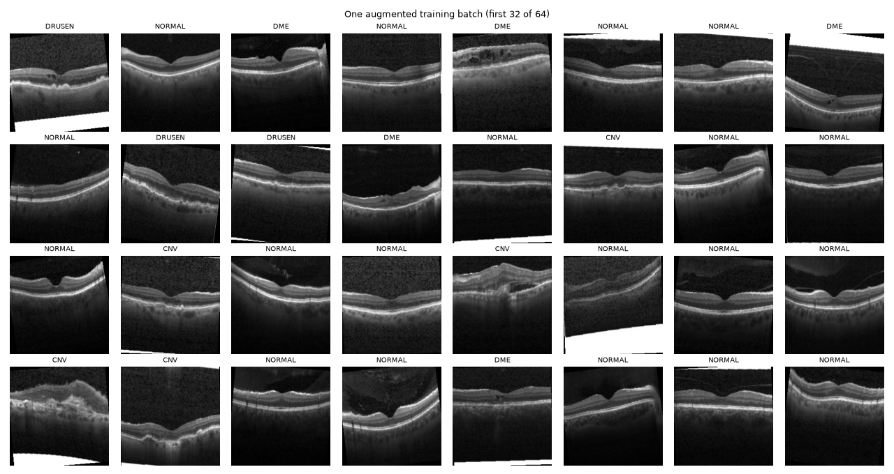
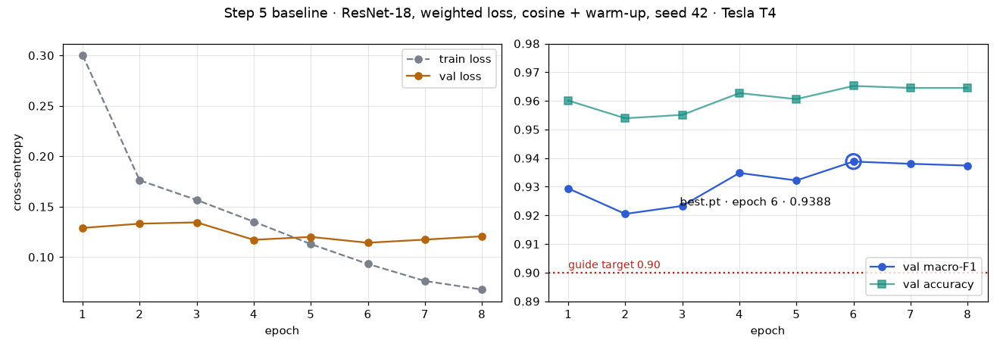
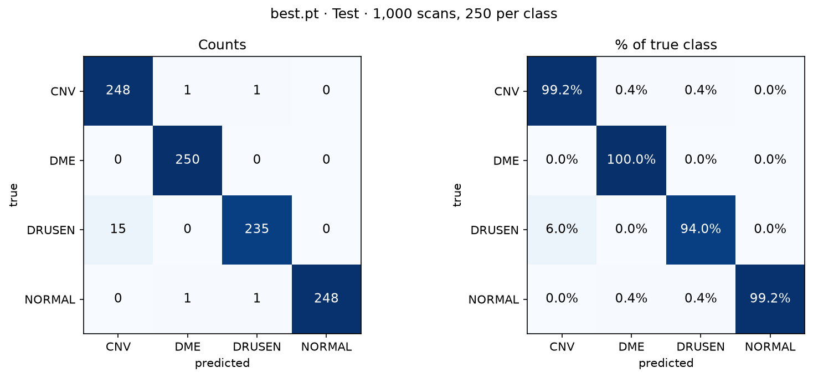
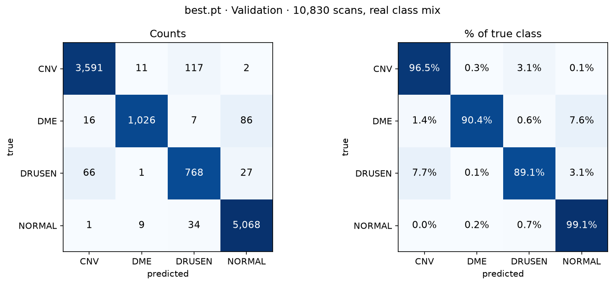

# Notes

**Code layout rule:** real code lives in `.py` files under `src/`. The notebook only clones the repo and calls those files.

## Progress

Steps 1–5 done in 5 days, on the build guide's plan. Step 5 took 1 day instead of 2 and caught up the day lost in Steps 1–4. At plan pace, the finish (Step 11) is the end of **Wed 4 Nov**.

## Daily log

One entry a day: what I tried, what broke, what I learned. Newest first.

<b>Tue 27 Oct 2026</b>

- Reran Step 5 as a clean notebook (Settings, Clone, Copy, Load, Checks, Smoke, Full run, Results with `RUN_*` switches). The saved run gave **bit-identical logits** to Monday's run: same seed, same code, same result.
- Started Step 6 on the `step6-evaluation` branch. Read the Step 6 concepts page (per-class metrics, confusion matrix, AUC, bootstrap, image vs patient resampling) and made the four decisions (see Step 6).
- `src/evaluate.py` written; runs locally on the saved logits in about 9 s. Test macro-F1 **0.981 (95% CI 0.971–0.990, by patient)**.
- Merged Step 6 (PR #3). Started Step 7 on `step7-calibration` and read its concepts page.
- **Surprise in the preview:** temperature scaling fitted on validation (T = 1.25) halves validation ECE but doubles test ECE. The first explanation (the class mix) was wrong: reweighting validation to 25% per class moves T to 1.48, the wrong way.
- **New finding while checking the second explanation:** 94% of test scans are 1024×496, a size that is only 0.4% of train and validation. The test set is a different acquisition, not just a cleaner one. Image sizes had only ever been compared by class, never by split.
- Went back over earlier notes and marked explanations that were stated as facts without a check (see Step 7 · What I got wrong).

<b>Mon 26 Oct 2026</b>

- Started Step 5 on the `step5-baseline` branch. Read the Step 5 concepts page (training loop, transfer learning, loss, learning rate, imbalance, macro-F1, checkpoints, GPU budget, debugging recipe).
- Decisions: class-weighted loss, cosine schedule with warm-up, seed 42 (see Step 5).
- `src/model.py` and `src/train.py` written. Local CPU check: first loss 1.62 (≈ ln 4 = 1.39, slightly above because the new head starts random), overfit one batch 1.50 → 0.0001 in 25 steps, tiny `fit` saves best.pt, log.csv and both logits files.
- On Kaggle (Tesla T4): first loss 1.621, overfit one batch → 0.0. Smoke test, 3 epochs on 10,000 scans: val macro-F1 **0.910**, test 0.975, 37 s per epoch. Fixed a PyTorch warning: with mixed precision the scaler can skip an optimiser step, so the scheduler now skips with it.
- New notebook: turning Internet on restarts the session (lost `sys.path`), and a failed clone leaves Python caching "no module here". The setup cell now clears that cache and checks everything up front.
- Full run as a saved version (data copy 63 s, then 8 epochs × ~262 s on a T4): best val macro-F1 **0.9388** at epoch 6, test 0.981. DRUSEN is the weakest class (val F1 0.86), confused mostly with CNV. Step 5 done.
- Merged Step 5 into `main` (PR #2, squash). Updated the timeline: back on the plan, projected finish Wed 4 Nov.

<b>Sun 25 Oct 2026</b>

- Started Step 4 on the `step4-pipeline` branch.
- Loaded one scan with `decode_image`: `uint8`, 1 channel (grayscale), 496×1024.
- Experiment 1: resize straight to 224×224 vs pad to a square first. Only matters for the wide scans (~38%): resize squashes 1536×496 to a third of its width, padding leaves only 32% of the image as retina.
- Found that **all 8,659 scans at 512×512 are DME** (about 75% of DME scans), probably a different scanner or clinic. Possible shortcut: the model could learn the scanner instead of the fluid. Table: `results/step4_size_by_class.csv`. Check with Grad-CAM in Step 9.
- Kaggle dataset usability score 5.0 → 8.13 (description, tags, sources, cover image).
- Experiments 2 and 3: 3 channels → resize → float → ImageNet normalise gives `[3, 224, 224]`, values −2.1 to 2.6; augmented copies still look like real retinas. `RandomResizedCrop` must come after `Resize`, or wide scans lose most of their width.
- Wrote `src/dataset.py` (`OCTDataset`, `build_transforms`, `make_loaders`). Local checks pass: 97,479 / 10,830 / 1,000, batch `(64, 3, 224, 224)`, val identical on reload, first batch 0.5 s.
- Checked all 109,309 image modes: grayscale except 2 RGB scans, both drusen test scans at one-off sizes (642×277, 900×455). `dataset.py` reads everything as grayscale.
- Loader on Kaggle: 106 images/s. Profiled 200 scans: 99.7 ms reading each file from Kaggle's network disk vs 5.8 ms for transforms, so the disk is the bottleneck. Fix: resized all 109,309 scans to 256×256 grayscale on my Mac (49 s) and uploaded them as the private dataset `zyanislam/kermany-retinal-oct-v3-256` (2.4 GB vs 7 GB).
- On the 256 dataset the first run was no faster (58 images/s, 64 ms decode): Kaggle's input disk waits about 60 ms the first time each file is read, whatever its size. A rerun in the same session was fast: **321 images/s**, decode 3.1 ms, transform 7.3 ms. Files are cached once read, and `build_index` (which opens every file) warms the cache. Transforms are now the slowest part. An epoch of 97,479 scans ≈ 5 min.
- Fresh sessions (saved runs) don't have the cache, so they were back at 107 images/s. Added a cell that copies the 256 dataset to local disk (`/tmp/oct256`, 65–68 s with 64 threads): saved runs now reach **359–489 images/s**, first batch about 1 s. In an interactive session, wait for Kaggle's own dataset download to finish before copying, or the copy crawls. Removed the original 7 GB dataset from the notebook's inputs, since every run downloads all inputs. All numbers: `results/step4_loader_speed.csv`.
- Plotted one augmented training batch: believable retinas, mixed classes, nothing upside down (`figures/step4/augmented_batch.png`). Step 4 done.

<b>Sat 24 Oct 2026</b>

- Moved Step 2 to a Kaggle notebook (`zyanislam/oct-calibration`).
- Built an index table (path, split, class, patient, width, height): 0 malformed names, 0 class mismatches, 0 unreadable files.
- Found the Kaggle `kermany2018` copy is the older v2 (84,484 images, stored twice), so I uploaded my local Mendeley v3 copy as the private dataset `zyanislam/kermany-retinal-oct-v3`.
- Reran the index on v3: 109,309 images (108,309 train, 1,000 test), all checks 0.
- Image sizes vary (8 different sizes, see `results/step2_image_sizes.csv`).
- Patients: 4,785 train, 635 test, 0 in both; 787 span more than one class.
- Saved a 20-scan grid per class.
- Step 3: wrote `src/data.py`; the patient split on Kaggle didn't match my Mac.
- Traced it to scikit-learn versions changing `StratifiedGroupKFold`'s shuffle (Kaggle val was 42.5% CNV vs 34.4% in train).
- Fixed with `shuffle=False` and a fold number: identical split on 3 versions.
- Reran on Kaggle with `fold=0`: same 97,479 / 10,830 / 1,000 split, identical row by row to my Mac.
- Saved `splits/oct_split_fold0.csv` and `notebooks/02_patient_split.ipynb`.
- Wrote down why splitting by image would inflate accuracy (Step 3 "done when").

<b>Fri 23 Oct 2026</b>

- Added the build guide + roadmap to `docs/`, a `.gitignore` (runs/, CellData/, kaggle.json) and this file.
- Counted images per class (train is very imbalanced: NORMAL 51k vs DRUSEN 8.6k; test is 250 each).
- Labelling practice: Round 1 3/8 → Round 2 6/8 → Round 3 8/8.
- Learned to check the RPE line first; CNV was my weak class, now drusen vs CNV is.
- Round 3 was drusen/CNV heavy and I got all 8: "smooth & sharp vs fuzzy & broken" works.

<b>Thu 22 Oct 2026</b>

- Created the `oct-calibration` repo, Colab notebook (T4) and Kaggle token (Step 1).
- Downloaded Kermany OCT2017 (Step 2).

## Steps

<strong>Step 1 · Workspace</strong>

- Public GitHub repo `zyanislam/oct-calibration` with `src/`, `notebooks/`, `runs/` (gitignored) and this file.
- Work runs in a Kaggle notebook (`zyanislam/oct-calibration`) that clones the repo and calls `src/`. Colab was the first plan; Kaggle won because the data can be attached and the GPU quota is larger.
- Kaggle API token set up locally so notebooks and outputs can be pulled into the repo.
- Code layout rule (top of this file): real code in `src/`, notebooks stay thin.
- From Step 4 on: one branch per step (`stepN-name`), merged to `main` with a pull request.

<strong>Step 2 · Data</strong>

Kermany OCT2017, local copy in `CellData/OCT/` (gitignored).

**Dataset version: Mendeley v3** ([doi:10.17632/rscbjbr9sj.3](https://data.mendeley.com/datasets/rscbjbr9sj/3)), the release used in Kermany et al. 2018 (*Cell*). On Kaggle I use my private copy `zyanislam/kermany-retinal-oct-v3` ("Kermany Retinal OCT (Mendeley v3)"), not `paultimothymooney/kermany2018`. That one is the older v2 (Mar 2018): 83,484 train with only 26,315 NORMAL, and 968 test (242 per class). It also contains the whole dataset twice (`OCT2017 /` and `oct2017/OCT2017 /`, with a trailing space in the folder name).

| Class  | Train  | Test |
|--------|-------:|-----:|
| CNV    | 37,205 | 250  |
| DME    | 11,348 | 250  |
| DRUSEN |  8,616 | 250  |
| NORMAL | 51,140 | 250  |

Largest / smallest train class ratio: 

51,140 : 8,616 = 5.935 : 1

- For 1 sample of DRUSEN, there are almost 6 samples from the NORMAL class.

### Patients (v3, from the Kaggle index)

| Split | Unique patients | CNV | DME | DRUSEN | NORMAL |
|-------|----------------:|----:|----:|-------:|-------:|
| train | 4,785 | 791 | 709 | 713 | 3,434 |
| test  |   635 | 178 | 167 | 169 |   171 |

- **Patients in both train and test: 0.** The official v3 test set is already patient-disjoint, so Step 3 removes no one from training (still keep the assert).
- **787 patients have scans in more than one class**, so the Step 3 split must group on patient only, never patient + class.
- Train scans per patient: min 1, median 10, max 813. A few patients contribute hundreds of scans, so the same patient shows up several times in a random sample (e.g. 904464 and 6668596 twice in the CNV grid).
- Image sizes: 8 different sizes. Most are 512×496 (58,037), 768×496 (29,749), 1536×496 (11,512), 512×512 (8,659) and 1024×496 (1,329), plus a few odd ones (384×496, 642×277, 900×455). Not all are 496 px tall, so resizing in Step 4 must handle both the width and the height. Full table: `results/step2_image_sizes.csv`.

### Sample grids (20 random train scans per class, seed 42)

What each class looks like:

- CNV: RPE lifted into one big irregular hump with a dark shadow below.
- DME: It has a few dark fluid pockets inside the swollen retina.
- DRUSEN: It contains a row of small, regular bumps on the RPE. The retina above is intact and the fovea is still visible.
- NORMAL: no dark pockets or bumps present insight. Smooth RPE with a clean dip in the center.

<strong>Step 3 · Patient split</strong>

Code: `src/data.py` (`build_index`, `patient_split`, `check_no_leak`). Split saved as `splits/oct_split_fold0.csv` (`path, label, patient, split`); every later step reads this file.

- Official train → train/val by patient with `StratifiedGroupKFold` (10 groups, group 0 = val). The official test set is unchanged.
- Train patients also in test: 0 removed. The `check_no_leak` assert passes.

| Split | Scans | Patients | CNV | DME | DRUSEN | NORMAL |
|-------|------:|---------:|----:|----:|-------:|-------:|
| train | 97,479 | 4,303 | 34.4% | 10.5% | 8.0% | 47.2% |
| val   | 10,830 |   482 | 34.4% | 10.5% | 8.0% | 47.2% |
| test  |  1,000 |   635 | 25% | 25% | 25% | 25% |

### Finding: a fixed seed was not enough for a reproducible split

My first split used `StratifiedGroupKFold(shuffle=True, random_state=42)`. On Kaggle it produced a different validation set from the same code on my Mac, because Kaggle has an older scikit-learn (1.6/1.7 reproduce it exactly; 1.9 differs). The Kaggle split was also badly balanced:

| Val share | Train | Shuffled val (Kaggle) | Fixed val |
|-----------|------:|----------------------:|----------:|
| CNV    | 34.4% | **42.5%** | 34.4% |
| DME    | 10.5% |  8.0% | 10.5% |
| DRUSEN |  8.0% |  **6.6%** |  8.0% |
| NORMAL | 47.2% | 42.9% | 47.2% |

Only 44 of the 473 shuffled-val patients are also in the fixed val set. Fix: `shuffle=False`, choosing the val group with `fold=0` instead of a seed. Tested on scikit-learn 1.6.1, 1.7.2 and 1.9.1: identical split. Full numbers: `results/step3_split_comparison.csv`.

**Lesson:** the seed fixes randomness *inside* a library version, not *across* versions. Save the split as a file and have every step read it, instead of recomputing it.

**Why splitting by image would inflate accuracy:**
If we split by image, the same patient's scans can appear in both the training and validation, as the model has seen the answers during training, it will recognise the eye it already knows, as the scans are nearly identical, recall that eye's label and get it right even though it never learned what each class looks like. Thus the score will look better than it really is but will struggle when new scans of new patients will be given. If the patient repeats, the near identical scans will be an easy find for the model as it already knows the eye, retina and the day the scans were taken. Inflated Accuracy means the model will do worse on new patients.

<strong>Step 4 · Data pipeline</strong>

Goal: train / val / test DataLoaders that read `splits/oct_split_fold0.csv` and load a batch in under a second.

### First scan

`decode_image("test/CNV/CNV-1032178-1.jpeg")` → `torch.uint8`, shape `[1, 496, 1024]`: one channel (grayscale), values 0–255. Needs copying to 3 channels for the pretrained ResNet, and converting to float before `Normalize`.

### Experiment 1 · Resize vs pad to square

| Size | Share of scans | Resize: horizontal squash | Pad: share of image that is retina |
|------|---------------:|--------------------------:|-----------------------------------:|
| 512×496 | 53% | 0.97 | 97% |
| 768×496 | 27% | 0.65 | 65% |
| 1536×496 | 11% | 0.32 | 32% |
| 512×512 | 8% | 1.00 | 100% |
| 1024×496 | 1% | 0.48 | 48% |

The choice barely matters for 61% of scans and matters a lot for the wide ones.

### Finding · Every 512×512 scan is DME

All 8,659 scans at 512×512 are DME, about 75% of DME scans (`results/step4_size_by_class.csv`). They probably come from a different scanner or clinic, so the model could learn the scanner instead of the fluid. Padding would make this worse (512×512 scans would be the only ones with no black bars). Check with Grad-CAM in Step 9, and report DME results for 512×512 and other sizes separately.

### Loader speed

| Setup | Images/s |
|-------|---------:|
| Original v3, Kaggle input disk | 106 |
| 256×256, Kaggle input disk, fresh session | 107 |
| 256×256 copied to local disk | **359–489** |

Kaggle's input disk waits on the first read of every file; a 65 s copy to `/tmp` at the start of each session removes that. Transforms (5–7 ms per scan) are now the slowest part.

### One augmented training batch

### Decisions

- **Resize strategy:** plain resize to 224x224. It won't create a giveaway for DME, will keep the details where they matter and match the already published work making them comparable to theirs. The only cost: wide scans are squashed; keep-aspect resizing is a possible later experiment.
- **Grayscale to 3 channels:** ResNet-18 is trained on coloured images (3 channels: r, g, b) and our scans have 1 channel (grey), so a 1-channel image won't run through it. I copy the grey channel 3 times (`v2.Grayscale(num_output_channels=3)`) rather than changing the network's first layer to take 1 channel, because copying keeps the pretrained weights usable unchanged. It is the first step of the transform, before the resize. Moving it after the resize would give the same result with a third of the resize work, a small speed-up now that transforms are the slowest part.
- **Augmentation values:** the model will be given a slightly different version of each training scan. This helps it learn how CNV looks, not the exact image of CNV, which reduces overfitting. Training only; val and test get the resize alone, so their results don't change between runs.
  - **Slight random crop**, keeping 85–100% of the image at a near-square shape (`scale=(0.85, 1.0)`, `ratio=(0.9, 1.1)`), done **after** the resize: scans aren't perfectly centred, and a bigger crop could cut off the lesion. On a raw 1536-wide scan a square crop would throw away two-thirds of the retina, which is why it comes after the resize.
  - **Horizontal flip** (50%): left and right eyes are mirror images, so a flipped scan is still realistic.
  - **Rotation** up to ±10°: patients' heads tilt slightly, and much more than that never happens in real scans.
  - **Brightness and contrast** ±10%: scanners and clinics differ in brightness, and this may also weaken the 512×512 scanner shortcut.
  - **No vertical flip:** an upside-down retina never occurs in a real OCT scan (vitreous on top, choroid at the bottom), so it would teach the model something impossible.

<strong>Step 5 · Baseline</strong>

ImageNet-pretrained ResNet-18, all layers fine-tuned, 4-class head (`src/model.py`); training loop in `src/train.py`.

### Decisions

- **Class imbalance: class-weighted loss**, not the sampler. With the sampler, the 7,754 DRUSEN training scans would repeat about 5 times per epoch, which risks overfitting on them; with a weighted loss every scan is seen once per epoch. Weights are n_total / (4 × n_class): CNV 0.73, DME 2.39, DRUSEN 3.14, NORMAL 0.53. Consequence for Step 7: weighting makes every class push about equally, so the model's prior is close to balanced. That matches the balanced test set better than the validation set (real mix), which is where temperature is fitted.
- **Schedule: cosine with a short warm-up** (5% of steps). The warm-up stops the new random head from sending large gradients into the pretrained layers at the start; one-cycle can work well but has more settings to get right.
- **Seed: 42**, set for `random`, `numpy` and `torch`. A seed makes the run's random choices (head initialisation, shuffle order, augmentation) repeat, so a change in results can be traced to a change in the code. It doesn't give bit-identical results across machines or library versions, and one seed is one sample; Step 10's ensemble uses several.
- **Left off on purpose:** label smoothing and focal loss, which change confidence by themselves and would blur Step 7.

### Debugging checks

| Check | Result |
|-------|--------|
| First loss (≈ ln 4 = 1.39) | 1.62 on CPU, before training |
| Overfit one batch | 1.50 → 0.0001 in 25 steps on CPU; 1.37 → 0.0 in 10 steps on the T4 |
| First loss on the T4 | 1.621 |
| Smoke test (3 epochs, 10,000 train scans) | val macro-F1 0.885 → 0.907 → **0.910**, val accuracy 0.949; test macro-F1 0.975. 37 s per epoch on a T4 |
| **Full run (8 epochs, 97,479 train scans)** | best val macro-F1 **0.9388** (epoch 6), val accuracy 0.965; test macro-F1 **0.981**, accuracy 0.981. ~262 s per epoch, 36 min in total, T4 |

### Full run

| Epoch | Train loss | Val loss | Val acc | Val macro-F1 |
|------:|-----------:|---------:|--------:|-------------:|
| 1 | 0.300 | 0.129 | 0.960 | 0.929 |
| 2 | 0.176 | 0.133 | 0.954 | 0.921 |
| 3 | 0.157 | 0.134 | 0.955 | 0.923 |
| 4 | 0.135 | 0.117 | 0.963 | 0.935 |
| 5 | 0.113 | 0.120 | 0.961 | 0.932 |
| 6 | 0.093 | 0.114 | 0.965 | **0.939** ← best.pt |
| 7 | 0.076 | 0.117 | 0.965 | 0.938 |
| 8 | 0.068 | 0.121 | 0.965 | 0.937 |

Reading the curves (check 7): validation is already strong after epoch 1, wobbles while the learning rate is high (epochs 2–3), then improves as the cosine schedule lowers it. After epoch 6, training loss keeps falling but validation loss creeps up and macro-F1 flattens: the start of overfitting, which `best.pt` (epoch 6) sidesteps. More epochs wouldn't help.

**Per class** (`results/step5_per_class.csv`): DRUSEN is the weakest class, F1 0.859 on val (precision 0.83, recall 0.89). Most of its errors are with CNV: 117 CNV scans predicted DRUSEN and 66 DRUSEN predicted CNV, the same pair I mixed up in labelling Round 2. DME recall is 0.90 on val, with 86 DME scans called NORMAL. On test, 15 of 250 DRUSEN scans are called CNV.

Test (0.981) is well above val (0.939). The test set is balanced like the model's prior (weighted loss) and is the cleaner official set. Model choices are made on validation only.

> **Correction (Tue 27 Oct):** this explanation was a guess, not a check. Step 7 found that 94% of test scans are 1024×496, a size that is only 0.4% of train and validation, so test is a different acquisition. Reweighting validation to the balanced mix doesn't make it behave like test, so the balance isn't the main reason either. See Step 7.

Logits are saved as `logits_val.pt` and `logits_test.pt` (logits, labels, rows). `rows` index the split's rows in `splits/oct_split_fold0.csv`, which gives the file path and patient. Outputs are in `runs/step5_baseline/` (gitignored, 45 MB checkpoint).

<strong>Step 6 · Evaluation</strong>

Metrics, bootstrap intervals and confusion matrices from the saved Step 5 logits (`src/evaluate.py`). No retraining and no GPU.

### Decisions

- **Bootstrap unit: both, patient-level is the headline.** Scans from one patient aren't independent, and patients have been the unit since the Step 3 split. The image-level interval is reported beside it for accuracy and macro-F1, to show how much the unit matters. 1,000 resamples, seed 42.
- **Intervals on:** accuracy, macro-F1, per-class recall and per-class F1. **Point values only:** per-class precision (depends on class prevalence, and the test set is artificially balanced) and one-vs-rest AUC (at the ceiling, 0.997–1.0).
- **Test is the headline, validation alongside** as point values. The balanced test set hides the real class mix and a second weak spot (DME→NORMAL on validation). Validation chose `best.pt`, so it's slightly optimistic.

### Results (test, 1,000 scans, 635 patients)

| Metric | Test | 95% CI by patient | 95% CI by image | Validation |
|---|---:|---:|---:|---:|
| Accuracy | 0.981 | 0.971–0.990 | 0.972–0.989 | 0.965 |
| Macro-F1 | 0.981 | 0.971–0.990 | 0.972–0.989 | 0.939 |

| Class | Precision | Recall (95% CI) | F1 (95% CI) | AUC |
|---|---:|---:|---:|---:|
| CNV | 0.943 | 0.992 (0.980–1.000) | 0.967 (0.947–0.984) | 0.999 |
| DME | 0.992 | 1.000 (1.000–1.000) | 0.996 (0.989–1.000) | 1.000 |
| DRUSEN | 0.992 | **0.940 (0.904–0.969)** | 0.965 (0.945–0.982) | 0.997 |
| NORMAL | 1.000 | 0.992 (0.979–1.000) | 0.996 (0.989–1.000) | 1.000 |

Tables: [`results/step6_metrics.csv`](results/step6_metrics.csv), [`results/step6_per_class.csv`](results/step6_per_class.csv).

### The main confusion

15 of the 19 test mistakes are DRUSEN called CNV. DRUSEN is most often mistaken for CNV, likely because both raise the RPE (a hypothesis until Grad-CAM in Step 9); what separates them is subtle — drusen are small, smooth, regular bumps under intact layers, while CNV is an irregular hump often with fluid above it — the same distinction I got wrong in my first two labelling rounds.

My longer notes on it: in both images the RPE has bumps, but they are distinguishable once you've seen a few. I made that mistake myself in the first two rounds and then looked very carefully. Cues: whether the retinal layers above stay intact (mostly yes in DRUSEN), and fluid pockets, which point to CNV.

### What I learned

- **Patient vs image barely differs here** (patient interval 1.10× wider) because most test patients have one scan (median 1, max 18). Worth saying, not assuming.
- **DME recall's interval is 1.000–1.000.** With zero misses, no resample can produce one, so the bootstrap can't show uncertainty. A better statement is the "rule of three": 0 misses in 250 means the true miss rate is below about 3/250, so recall is at least about 0.988 with 95% confidence.
- **Validation shows a weak spot test hides:** 86 of 1,135 DME scans (7.6%) called NORMAL, against 0 on test.
- **Added Tue 27 Oct:** the intervals cover sampling noise within *this* test population only. Test is 94% one image size that training barely has (Step 7), so they say nothing about scans from another scanner.

<strong>Step 7 · Calibration</strong> (in progress)

ECE, reliability diagrams and temperature scaling, from the saved Step 5 logits. Concepts page: "Calibrating the OCT Baseline".

### Preview (quick numbers before writing `src/calibrate.py`)

| | ECE before (T = 1) | ECE after T = 1.25 (fitted on val) |
|---|---:|---:|
| Validation | 0.0133 | **0.0059** (better) |
| Test | **0.0069** | 0.0128 (about 2× worse) |

On validation the model is **over-confident** (confidence 0.978, accuracy 0.965), so T > 1 helps. On test it was **already calibrated** (confidence 0.981, accuracy 0.981), so the same T makes it under-confident. The T test itself would want is 1.05 (looked at for diagnosis only, never used).

### Why: two explanations tested

1. **The class mix (rejected).** Validation has the real mix, test is 25% per class. If that were the cause, refitting T on validation reweighted to 25% per class should move T towards 1.05. It moves to **1.48**, the wrong way.
2. **A different acquisition (supported, not proven).** Image size by split ([table](results/step7_size_by_split.csv)):

| Split | 1024×496 | 512×496 | 768×496 | 1536×496 | 512×512 | other |
|---|---:|---:|---:|---:|---:|---:|
| Train (97,479) | 0.4% | 53.5% | 27.5% | 10.6% | 8.1% | 0.0% |
| Validation (10,830) | 0.4% | 54.4% | 27.6% | 10.6% | 7.0% | 0.0% |
| Test (1,000) | **94.2%** | 0 | 0.4% | 5.2% | 0 | 0.2% |

Test is almost entirely a size the model barely saw in training, and test scans are also easier in every class (DME 1.000 vs 0.904 on validation, DRUSEN 0.940 vs 0.891). The size alone doesn't make scans easy: the 44 validation scans at 1024×496 are *less* accurate (0.909). So the test set differs in acquisition **and** difficulty, and these two can't be separated yet.

Two side results:
- **No 512×512 scans in test**, so the DME-only 512×512 shortcut (Step 4) can't inflate test scores. On validation, 512×512 DME accuracy (0.904) matches other DME, so there's no sign of a free ride.
- **The lesson for the project:** a calibration fitted on one population doesn't automatically transfer to another. A clinic's scans are more like validation than like a curated test set.

### What I got wrong (and how it was caught)

Numbers in these notes were computed and checked; some **explanations** of them were guesses written as facts.

- **"Test differs because of the class mix"** (Step 7 preview): rejected by the reweighting test above.
- **"Test is the cleaner official set"** (Step 5): incomplete; the image-size check shows a different acquisition. Corrected in Step 5.
- **Image sizes were compared by class only** (Steps 2 and 4), never by split, so the test-set difference went unnoticed for five steps.
- **"DRUSEN is confused with CNV because both raise the RPE"** (Step 6): a likely hypothesis, now worded as one; Grad-CAM in Step 9 can test it.
- **Step 6 intervals** describe this test population only; now said explicitly.

Rule from here: an explanation is marked as a hypothesis until a check backs it, and the check is written down.

<strong>Labelling practice</strong>

Can I tell the classes apart by eye? 2 random scans per class, shuffled, from `runs/quiz/quiz.png`.
Write my guess before checking `runs/quiz/answers.json`.

Anatomy reference (normal, DME, CNV, drusen with layers labelled):

### Round 1 · Fri 23 Oct 2026

| Scan | My guess | Why (what I saw) | Actual | Right? |
|-----:|----------|------------------|--------|:------:|
| 1 | DME | | DME | ✓ |
| 2 | (skipped) | | DRUSEN | – |
| 3 | DRUSEN | | CNV | ✗ |
| 4 | DME | | CNV | ✗ |
| 5 | DRUSEN | | DRUSEN | ✓ |
| 6 | NORMAL | | NORMAL | ✓ |
| 7 | (skipped) | | NORMAL | – |
| 8 | (skipped) | | DME | – |

Score: 3/8 (3/5 attempted)

Lessons:
- CNV vs DME: DME = many dark fluid pockets *inside* the retina (#1). CNV = the bright bottom layer (RPE) is lifted or broken by a mass *under* the retina, fluid on top is secondary (#4: one cyst, but the RPE below is humped up).
- CNV vs DRUSEN: drusen are small, regular bumps of the RPE with the retina above intact (#5). An irregular, larger RPE elevation with tissue/fluid around it is CNV (#3).
- NORMAL: smooth layers + clean foveal dip (#6, #7). The tilt/curve of the image doesn't matter.
- #2 is labelled DRUSEN but looks almost normal to me. Kermany labels are image-level and can be noisy; remember this for Step 7–8 (confident "mistakes" may be label errors).
- #8 (DME) is low quality and cropped: real data has bad scans too.

### Round 2 · Fri 23 Oct 2026

From `runs/quiz/round2/quiz.png`. Tip: check the RPE line first.

| Scan | My guess | Why (what I saw) | Actual | Right? |
|-----:|----------|------------------|--------|:------:|
| 1 | DME | | DME | ✓ |
| 2 | DRUSEN | | CNV | ✗ |
| 3 | NORMAL | | NORMAL | ✓ |
| 4 | DRUSEN | | DRUSEN | ✓ |
| 5 | CNV | | DRUSEN | ✗ |
| 6 | NORMAL | | NORMAL | ✓ |
| 7 | CNV | | CNV | ✓ |
| 8 | DME | | DME | ✓ |

Score: 6/8 (up from 3/8). Only error: swapped #2 and #5 (drusen vs CNV).

Lessons:
- #5 is DRUSEN even though the bumps are big and clustered: they are smooth, dome-shaped RPE elevations, the layers above follow them cleanly, and there's no fuzzy tissue or fluid. Size alone doesn't make it CNV.
- #2 is CNV: the RPE band is broken and messy (bright, fuzzy, ill-defined material under the retina) with the retina distorted above. Irregular and blurred, not smooth domes.
- #7: a single large, smooth dome is a pigment epithelial detachment (PED); in this dataset it was labelled CNV.
- #1 is DME but the scan is off-centre (the big dip on the left is the optic disc, not the fovea).
- Drusen vs CNV is my weak spot now. Next round: look for *smooth & sharp* (drusen) vs *fuzzy, broken, with fluid* (CNV).

### Round 3 · Fri 23 Oct 2026

From `runs/quiz/round3/quiz.png`. Weighted toward drusen vs CNV (not 2 per class). Smooth & sharp domes = drusen; fuzzy, broken RPE, fluid = CNV.

| Scan | My guess | Why (what I saw) | Actual | Right? |
|-----:|----------|------------------|--------|:------:|
| 1 | DRUSEN | | DRUSEN | ✓ |
| 2 | DRUSEN | | DRUSEN | ✓ |
| 3 | DME | | DME | ✓ |
| 4 | CNV | | CNV | ✓ |
| 5 | CNV | | CNV | ✓ |
| 6 | NORMAL | | NORMAL | ✓ |
| 7 | CNV | | CNV | ✓ |
| 8 | DRUSEN | | DRUSEN | ✓ |

Score: 8/8 (3/8 → 6/8 → 8/8). Drusen vs CNV sorted on the drusen/CNV-heavy round.

