# oct-calibration

**Can an eye-scan AI tell us when not to trust it?**


An AI that's right 98% of the time is still wrong sometimes, and on its own you can't tell which answers are the wrong ones. This project trains a model to read retinal scans, then tests whether it can say "I'm not sure, a doctor should look at this one", and whether that warning means anything.

**The main result: if a doctor checks the 9% of scans the AI is least sure about, about two-thirds of its mistakes get caught.** In numbers: if the model answers 91% of test scans and flags the rest, it catches 68% of its own mistakes (13 of 19; 95% CI 42–92%), and its accuracy on what it answers rises from 98.1% to 99.3%.

| Out of 1,000 test scans | Scans | Mistakes |
|---|---:|---:|
| AI answers everything | 1,000 | 19 |
| AI answers only when confident | 909 | **6** |
| Sent to a doctor | 91 | the other 13 are caught here |

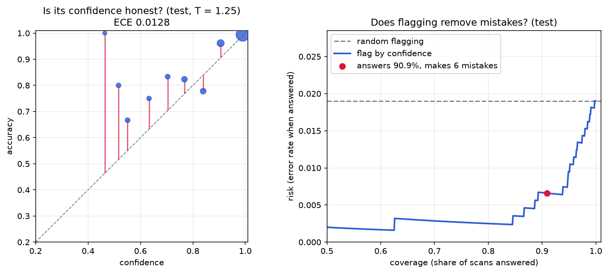

*Left: dots on the diagonal would mean "90% sure" is right 90% of the time. On test, dots sit above it, so the scaled model is a little under-confident. Right: flagging the least confident scans lowers the error rate on what's left, far faster than flagging at random.*

**Three honest limits.** The "two-thirds" rests on only 19 mistakes, so the true figure could be anywhere from about 40% to 90%. Training the same model again with a different random seed gave between 15 and 31 test mistakes, so the 19 is partly luck. And this isn't ready for a clinic: the test scans look different from the training scans, so results on another hospital's scans could differ. [All limitations](#limitations).

This is the imaging half of a wider question I work on: how to show model uncertainty to the people who rely on it. The other half is confidence cues on automatic captions for Deaf and hard-of-hearing viewers, where an unreliable "I'm unsure" flag is worse than none.

## Why this matters

**Accuracy alone isn't what stops these models being used.** Classifiers like this one have scored highly on this dataset since the original 2018 paper. What a clinic also needs is to know which answers to doubt, because a model that is right 98% of the time gives no warning on the other 2%. This project measures that directly: does low confidence point at the mistakes, with the threshold fixed in advance and ranges that account for patients?

**What it could mean in practice (an illustration, not a tested result).** Picture a screening service that receives 1,000 OCT scans a week. Today, someone reads all 1,000. With this setup, the model answers about 909, and an ophthalmologist reads the 91 it's least sure of. If this week behaved like the test set, 13 of the model's 19 mistakes would be among those 91, so only 6 would get through unchecked, instead of 19 with no check at all. That trade, reading 9% of scans to catch about two-thirds of the errors, is what a clinic would actually decide on.

**The checks matter as much as the result.** Several things here would have produced a confident, wrong write-up if I hadn't tested them:
- the official test set turned out to be a different kind of scan from training,
- a calibration fix that worked on validation didn't carry over to test,
- the random seed alone moved the score more than the reported range did,
- and five models together still shared the same confident mistakes.

These are the same traps that catch medical AI in published work, found here on a small scale.

**What it isn't.** It isn't a better classifier, a new method, or clinical evidence. The model is a standard ResNet-18, and nothing was tested with doctors or patients. The [limitations](#limitations) say what that leaves open.

## Results

Test ranges are 95% intervals from resampling whole patients. Thresholds and temperature come from validation only.

| | Test (1,000 scans) | 95% interval | Validation (10,830 scans) |
|---|---:|---:|---:|
| Macro-F1 | **0.981** | 0.971–0.990 | 0.939 |
| Accuracy | 0.981 | 0.971–0.990 | 0.965 |
| DRUSEN recall, the weakest class | 0.940 | 0.904–0.969 | 0.891 |
| Scans answered, at the 90% threshold | 90.9% | 88.9–93.0% | 90.0% |
| Accuracy on answered scans | **99.3%** | 98.6–99.9% | 99.0% |
| Mistakes caught by flagging | **13 of 19 (68%)** | 42–92% | 282 of 377 (75%) |
| AURC (random flagging / perfect ranking) | 0.0024 (0.0190 / 0.0002) | | 0.0059 |
| ECE before → after temperature scaling | 0.0069 → 0.0128 | change −0.0058 to +0.0116 | 0.0133 → 0.0059 (change −0.0120 to +0.0029) |

**Temperature scaling doesn't clearly help here.** It improves validation and worsens test, and both ranges include no change. So the supported claim is that there's no evidence T = 1.25 helps on test. Flagging works because confidence *ranks* mistakes well, and scaling never changes that ranking much (AURC 0.0023 before, 0.0024 after).

**A team of five models doesn't change the conclusion.** It makes 19 test mistakes too, and all test ranges include no change. On validation the gains are small but clear. All 7 confident mistakes across the two methods are drusen called CNV and are made by all five models, so one temperature number stays the main method ([details](#results-by-step)).

## Method

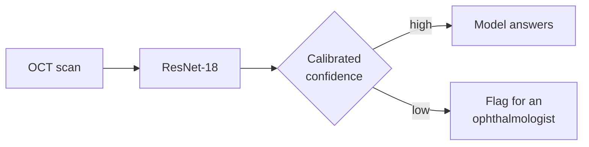

- **Data:** Kermany OCT2017, Mendeley v3: 109,309 scans of four classes (CNV, DME, DRUSEN, NORMAL), with the official balanced test set of 1,000 scans. Every scan was resized once to 256×256 for speed, in [a copy I made and published on Kaggle](#my-two-kaggle-copies).
- **Patient split:** each patient is on one side only, checked by an `assert`, because one patient can have hundreds of near-identical scans. The split is [saved as a file](splits/oct_split_fold0.csv) that every step reads.
- **Model:** ImageNet-pretrained ResNet-18, all layers fine-tuned, class-weighted loss, 8 epochs on one Kaggle GPU, best epoch chosen on validation macro-F1.
- **Calibration:** one temperature number, fitted on validation, divides the model's raw scores. It changes confidence and never the predicted class, and the code asserts this.
- **Selective prediction:** answer scans at or above a confidence threshold, set on validation for 90% coverage, and flag the rest.
- **Comparison:** a deep ensemble of 5 seeds, against the single model with temperature.

## Where the model looks

Heatmaps show which regions most influenced an answer. They show where the model looked, not why it was right.

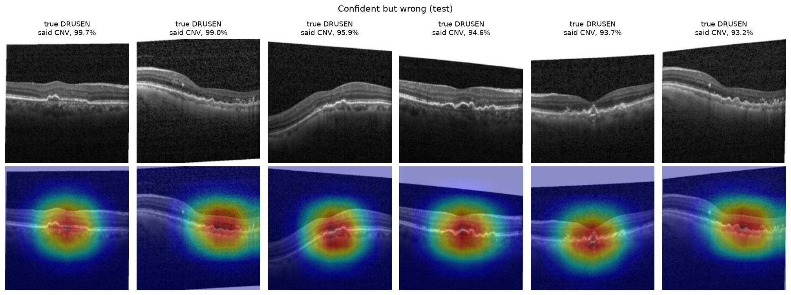

- **Measured:** test has exactly 6 mistakes above the confidence threshold. All 6 are drusen called CNV, from 5 patients. A doctor wouldn't be shown these.
- **Confident mistakes:** all have bumps along the RPE, often several and uneven, with heat on them. A hypothesis is that uneven drusen resemble the irregular CNV hump. Six scans can't prove it, and other bumpy drusen weren't confident mistakes.
- **Size shortcut:** in [six 512×512 DME scans](figures/step9/dme_512.png), heat is on fluid where it's visible, not on corners or borders. That shows no obvious shortcut there but can't rule one out.
- **Other panels:** [confident and right](figures/step9/confident_right.png), [least confident](figures/step9/least_confident.png). Scans shown are [listed here](results/step9_scans_shown.csv).
- **Caution:** the heat is nearly always a central blob on coarse 7×7 maps, and the retina usually sits in the middle, so "on the retina" may be partly a centring effect.

## Limitations

Each limit comes with what it could mean in practice. The examples are illustrations, not things that were tested.

- **One public dataset.** There's no outside test set, and nothing here was checked on another hospital's scans.
  *In practice:* a clinic with a different scanner brand, or a different patient population, might see more mistakes. Its 90% threshold could also flag far more or far fewer scans than planned. Something like this already happened between validation and test here.
- **The test set looks like a different acquisition.** 94% of test scans are one image size that is only 0.4% of training and validation scans ([finding 5](#the-data-and-how-to-test-fairly)), so test results describe that population, not OCT scans in general.
  *In practice:* temperature scaling improved calibration on validation and made it worse on test. A hospital's own scans could behave like a third population again, so its threshold and temperature would need checking on its own data.
- **Few test mistakes.** Every test result about mistakes rests on 19 of them, which is why the ranges are wide.
  *In practice:* "about two-thirds of mistakes get caught" honestly means "somewhere between 4 in 10 and 9 in 10". That's a big difference when deciding whether the safety net is good enough.
- **One seed is one sample.** Other seeds made 15 to 31 test mistakes, and the intervals above hold the model fixed, so they leave this out.
  *In practice:* retraining the same model next month, with nothing else changed, could give anything in that range. A reported 19 may be partly luck.
- **Image-level labels.** Each scan has one label with no lesion marked, and some labels may be wrong. I didn't check them.
  *In practice:* if a scan labelled drusen really shows early CNV, a correct answer counts as a mistake, and no interval shows that error. The [7 scans](results/step10_confident_mistakes.csv) that all five models call CNV are where I'd look first.
- **Scans are squashed.** Every scan was resized to 256×256 and then to 224×224, so a 1536×496 scan is squeezed sideways about three times more than top to bottom. This wasn't tested.
  *In practice:* small, closely spaced drusen could blur together and look more like one irregular CNV hump, which is the model's main mistake.
- **Heatmaps aren't explanations.** Grad-CAM shows where the model looked, and a shortcut through image size isn't ruled out.
  *In practice:* all 8,659 scans at 512×512 are DME. A model that learned "this scanner usually means DME" could still show heat on the retina and look reasonable.
- **No clinical validation.** Nobody has tested this with doctors or patients.
  *In practice:* at the 90% threshold, about 1 in 4 test drusen scans is flagged, against 1 in 17 to 1 in 42 for the other classes. A clinic that sees mostly early AMD would get a much heavier review load than the overall 9% suggests. Staff might also come to trust unflagged answers too much, and only a real study could measure that.

## Reproducing

```bash
git clone https://github.com/zyanislam/oct-calibration.git
cd oct-calibration
python3.12 -m venv .venv
.venv/bin/pip install -r requirements.txt
```

**No data or GPU needed for Steps 6, 7, 8 and 10.** The five models' saved outputs are in [`logits/`](logits/), so these run on a laptop from the repo folder with `.venv/bin/python`, and their numbers should match [`results/`](results/):

```python
from src.evaluate import evaluate_run
from src.calibrate import calibrate_run
from src.selective import selective_run, headline_figure
from src.ensemble import ensemble_run

run = "logits/seed_42"
summary, per_class = evaluate_run(run)                             # Step 6
T, table = calibrate_run(run, "figures/step7/reliability.png")     # Step 7
tables = selective_run(run, "figures/step8/risk_coverage.png")     # Step 8
headline_figure(run, "figures/step11/headline.png")                # the figure at the top

seeds = {s: f"logits/seed_{s}" for s in (42, 1, 2, 3, 4)}
team = ensemble_run(seeds, 42, "figures/step10/risk_coverage.png") # Step 10
```

**Steps 2–5 and Step 9 need the scans,** from [Mendeley v3](https://data.mendeley.com/datasets/rscbjbr9sj/3) (about 7 GB) or [my 256×256 copy on Kaggle](https://www.kaggle.com/datasets/zyanislam/kermany-retinal-oct-v3-256) (2.6 GB, what training used), and Step 9 also needs `best.pt` from training, which is too big to commit (45 MB). I resized every scan to 256×256 first, so full-size scans may give slightly different results. Training ran on a Kaggle T4 GPU with Kaggle's library versions, so a rerun elsewhere may not match exactly. The notebooks are [`04_baseline`](notebooks/04_baseline.ipynb) and, for seeds 1 to 4, [`05_ensemble`](notebooks/05_ensemble.ipynb).

```python
from src.data import build_index, patient_split
from src.dataset import make_loaders
from src.model import build_model
from src.train import class_weights, fit, set_seed
from src.gradcam import gradcam_run

index, problems = build_index("path/to/OCT")   # Step 2: expects train/ and test/ with one folder per class
split, removed = patient_split(index, fold=0)  # Step 3: same split as splits/oct_split_fold0.csv
loaders = make_loaders("path/to/OCT")          # Step 4: reads splits/oct_split_fold0.csv
set_seed(42)                                   # Step 5: about 36 min on a T4
fit(build_model(), loaders, "runs/step5_baseline", epochs=8,
    weights=class_weights(loaders["train"].dataset.labels))
shown = gradcam_run("runs/step5_baseline", "path/to/OCT", "figures/step9")   # Step 9, on CPU
```

## What I learned

**About the science**

- **Check explanations, not just numbers.** My numbers were right, but I wrote some explanations as facts. "Test differs because of the class mix" felt obvious, and a simple test rejected it: reweighting validation moved T to 1.48, the wrong way. Since then, an explanation stays a hypothesis until a check backs it, and the check is written down.
- **Compare things across splits, not only classes.** I compared image sizes by class in Steps 2 and 4 and never by split, so the odd test set went unnoticed until Step 7.
- **A calibration doesn't automatically carry over.** A number fitted on one population needn't suit another, which matters more for a clinic than a good score on a tidy test set.
- **Confidence can be useful without being perfectly calibrated.** Flagging depends on ranking, so it worked even where temperature scaling didn't clearly help.
- **A range can hide what it doesn't cover.** My intervals hold the model fixed, and the seed alone moved test mistakes from 15 to 31. The best validation seed also had the worst test score. With zero DME misses, the bootstrap gives no range at all, so I used the rule of three instead.
- **Averaging can't fix a shared mistake.** Five models were steadier, but they got the same confident mistakes wrong.
- **Learning to read the scans helped.** I labelled scans by eye first, going from 3/8 to 8/8. Drusen against CNV was my own last confusion, and it turned out to be the model's main mistake too.

**What broke, and how I fixed it**

- **A fixed seed didn't give the same split.** Kaggle and my laptop gave different validation sets, because `StratifiedGroupKFold` changed between scikit-learn versions. I fixed it with `shuffle=False` and saved the split as a file.
- **Training looked slow because of the disk.** I profiled it instead of guessing: reading files took 99.7 ms a scan and transforms 5.8 ms. Resizing once and copying to local disk raised speed from about 100 to 359–489 images/s.
- **Cropping before resizing would have cut away most of a wide scan.** I caught this in an early experiment, so the crop comes after the resize.
- **A new Kaggle session lost the code.** Turning Internet on restarts the session, and a failed clone leaves Python caching "no module here". The setup cell now clears that cache and checks everything first.
- **A PyTorch warning found a real ordering problem.** With mixed precision the scaler can skip an optimiser step, so the learning-rate schedule now skips with it.

The full day-by-day log is in [`NOTES.md`](NOTES.md).

## The four classes

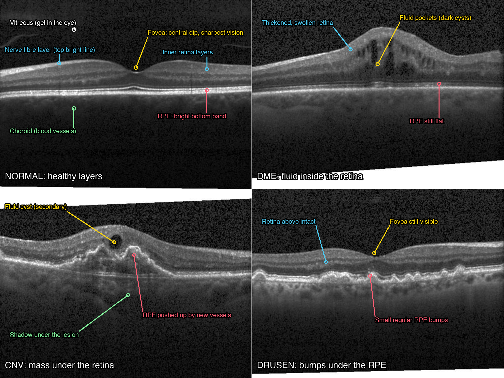

| Class | What it is | What to look for on the scan |
|---|---|---|
| **NORMAL** | Healthy retina | Smooth layers, a clean dip at the centre (the fovea) |
| **DME** | Diabetic macular edema | Dark fluid pockets *inside* a swollen retina; the bottom band (RPE) stays flat |
| **CNV** | Choroidal neovascularization (wet AMD) | The RPE pushed up into an irregular hump by new vessels underneath, often with fluid and a shadow |
| **DRUSEN** | Deposits under the retina (early AMD) | A row of small, smooth, regular bumps on the RPE, with the layers above intact |

Before writing any code, I learned to label these by eye. Over three practice rounds, I went from **3/8 to 6/8 to 8/8** ([notes](NOTES.md)).

## Other findings along the way

### The data and how to test fairly

**1. The popular Kaggle copy of this dataset is the old version.** (Step 1) `paultimothymooney/kermany2018` is Mendeley **v2**: 83,484 training scans with only 26,315 NORMAL, 242 test scans per class, and the whole dataset stored twice. The paper used **v3** (108,309 train, 1,000 test). There was no clean v3 copy on Kaggle, so I uploaded my own.

**2. Patients, not scans, are the unit that matters.** (Steps 2–3) One patient contributes up to 813 training scans, and 787 patients have scans in more than one class. If you split by image, the model can score well by recognising a patient's eye rather than the disease. Every split here keeps each patient on one side, and an `assert` checks it.

**3. A fixed random seed didn't make the split reproducible.** (Step 3) The same code with `seed=42` gave a different validation set on Kaggle than on my laptop: only 44 of 473 validation patients were the same. The cause was a change in scikit-learn's `StratifiedGroupKFold` between versions. Kaggle's split was also badly balanced:

| Validation set | CNV | DME | DRUSEN | NORMAL |
|---|---:|---:|---:|---:|
| Training set (target) | 34.4% | 10.5% | 8.0% | 47.2% |
| Shuffled split, Kaggle's scikit-learn | **42.5%** | 8.0% | **6.6%** | 42.9% |
| Fixed split, `shuffle=False` | 34.4% | 10.5% | 8.0% | 47.2% |

The fix gives an identical split on scikit-learn 1.6, 1.7 and 1.9, and the split is saved as a file that every later step reads ([comparison](results/step3_split_comparison.csv)).

**4. The scans aren't one size, and one size gives away a class.** (Steps 2 and 4) There are 8 image sizes, from 512×512 to 1536×496 ([table](results/step2_image_sizes.csv)). **Every 512×512 scan is DME**: 8,659 scans, about 75% of all DME ([table](results/step4_size_by_class.csv)). They probably come from a different scanner or clinic, so a model could learn the scanner instead of the disease. That decided the resize: a plain resize to 224×224, because padding to a square would leave black bars on every scan except those DME ones. Grad-CAM in Step 9 found no obvious sign of the shortcut in the scans checked, which doesn't rule it out.

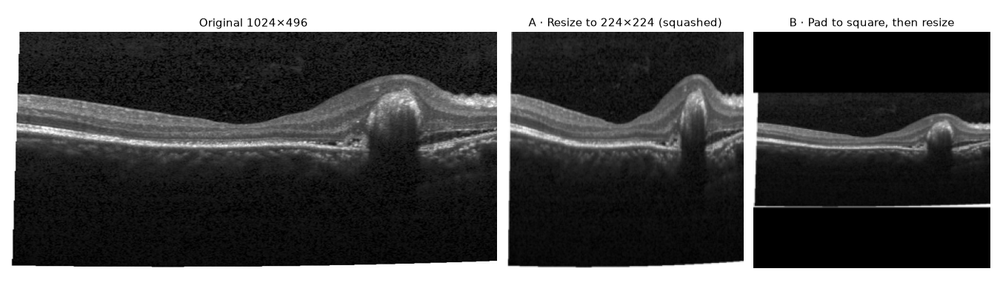

**5. The official test set looks like a different acquisition.** (Step 7) 94% of test scans are 1024×496, a size that is only 0.4% of the training and validation scans ([table](results/step7_size_by_split.csv)). Test scans are also more accurately classified in every class. So test scores and test calibration describe one particular population, not "OCT scans in general". Test also has no 512×512 scans, so the DME shortcut (finding 4) can't inflate test scores. I only noticed this in Step 7, because image sizes had been compared by class but never by split. Whether acquisition is what causes the higher accuracy isn't established: the 44 validation scans at 1024×496 are less accurate (0.909).

### The pipeline

**6. Loading the data was the first bottleneck, not the model.** (Step 4) Reading scans straight from Kaggle's input disk gave about 100 images/s, because the disk waits on the first read of every file. Resizing every scan once to 256×256 and copying them to local disk at the start of each session (about 65 s) raised it to **359–489 images/s**: about 3–4 minutes of loading per epoch instead of 15 ([numbers](results/step4_loader_speed.csv)).

**7. Almost every scan is grayscale.** (Step 4) 109,307 of 109,309 are single-channel; the two RGB exceptions are drusen test scans at one-off sizes ([table](results/step4_image_modes.csv)). The pipeline reads every scan as grayscale and copies it to the 3 channels the pretrained network expects.

### Training the same model again

**8. The random seed alone moves the score.** (Step 10) Five runs with the same data, settings and code made 15, 19, 23, 25 and 31 test mistakes. The range in Step 6 (macro-F1 0.971–0.990) shows how much the score moves with different patients, but it holds the model fixed, so it leaves this out. Validation wouldn't have picked the best run either: seed 1 had the best validation score and the worst test score ([table](results/step10_members.csv)).

**9. A team can't fix a mistake that all its members share.** (Step 10) All 7 confident test mistakes across the single model and the team are drusen called CNV, and all five models get each one wrong. The models disagree on only 32 of 1,000 test scans. Why they agree isn't established ([scans and votes](results/step10_confident_mistakes.csv)).

## Results by step

<details>
<summary><b>Step 5 · Baseline</b>: validation macro-F1 0.939</summary>

ImageNet-pretrained ResNet-18, all layers fine-tuned, class-weighted loss, AdamW with cosine warm-up, mixed precision, 8 epochs, seed 42, one Tesla T4 (36 min). A clean rerun gave bit-identical logits.

| | Accuracy | Macro-F1 |
|---|---:|---:|
| Validation (10,830 scans, real class mix) | 0.965 | **0.939** |
| Test (1,000 scans, balanced) | 0.981 | 0.981 |

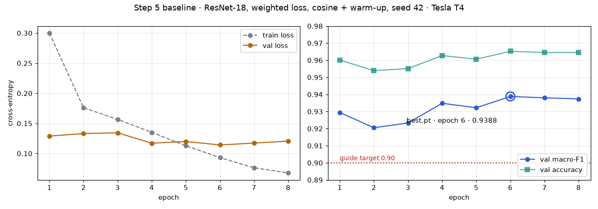

The weakest class is DRUSEN (validation F1 0.86), mostly confused with CNV ([per class](results/step5_per_class.csv)).

</details>

<details>
<summary><b>Step 6 · Evaluation</b>: test macro-F1 0.981 (95% CI 0.971–0.990)</summary>

95% intervals from 1,000 bootstrap resamples of the test set. The headline resamples **patients** (the 1,000 test scans come from 635 patients, and scans of one eye aren't independent); resampling images gives a slightly narrower interval.

| Test set | Value | 95% CI, by patient | 95% CI, by image | Validation |
|---|---:|---:|---:|---:|
| Accuracy | 0.981 | 0.971–0.990 | 0.972–0.989 | 0.965 |
| Macro-F1 | **0.981** | **0.971–0.990** | 0.972–0.989 | 0.939 |

| Class | Recall (95% CI) | F1 (95% CI) | Precision | AUC |
|---|---:|---:|---:|---:|
| CNV | 0.992 (0.980–1.000) | 0.967 (0.947–0.984) | 0.943 | 0.999 |
| DME | 1.000 | 0.996 (0.989–1.000) | 0.992 | 1.000 |
| DRUSEN | **0.940 (0.904–0.969)** | 0.965 (0.945–0.982) | 0.992 | 0.997 |
| NORMAL | 0.992 (0.979–1.000) | 0.996 (0.989–1.000) | 1.000 | 1.000 |

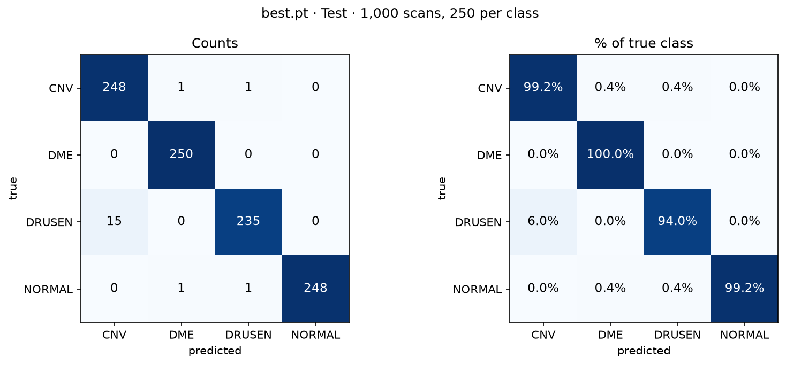

**The main confusion is DRUSEN read as CNV: 15 of the 19 test mistakes.** Likely because both raise the RPE, and what separates them is subtle (a hypothesis; Step 9's heatmaps fit it but can't prove it). Drusen are small, smooth, regular bumps under intact layers, while CNV is an irregular hump, often with fluid above it. It's the same distinction I got wrong in my first two labelling rounds.

Four things the table doesn't show on its own:
- **The balanced test set hides a second weak spot.** On validation (real class mix), 86 of 1,135 DME scans (7.6%) were called NORMAL; on test, none were ([confusion matrix](figures/step6/confusion_val.png)).
- **DME recall has no bootstrap interval.** With zero misses, no resample contains one. By the rule of three, 0 misses in 250 still means recall is at least about 0.988 with 95% confidence.
- **The intervals cover sampling noise within this test set only.** Test is almost all one image size that training barely contains (finding 5), so they don't say how the model does on another scanner.
- **Precision and AUC get point values only.** Precision depends on class prevalence, which the balanced test set fixes at 25%; AUC is at its ceiling.

</details>

<details>
<summary><b>Step 7 · Calibration</b>: over-confident on validation; T = 1.25 doesn't clearly carry over to test</summary>

T is fitted on validation only. Scaling never changes a prediction, and the code asserts this. Equal-width ECE with 15 bins is the headline ([table](results/step7_calibration.csv)).

| | Mean confidence | Accuracy | ECE | ECE, equal-mass | NLL | Brier |
|---|---:|---:|---:|---:|---:|---:|
| Validation, before | 0.978 | 0.965 | 0.0133 | 0.0127 | 0.1142 | 0.0544 |
| Validation, T = 1.25 | 0.967 | 0.965 | **0.0059** | 0.0075 | 0.1088 | 0.0533 |
| Test, before | 0.981 | 0.981 | **0.0069** | 0.0043 | 0.0682 | 0.0342 |
| Test, T = 1.25 | 0.970 | 0.981 | 0.0128 | 0.0128 | 0.0703 | 0.0346 |

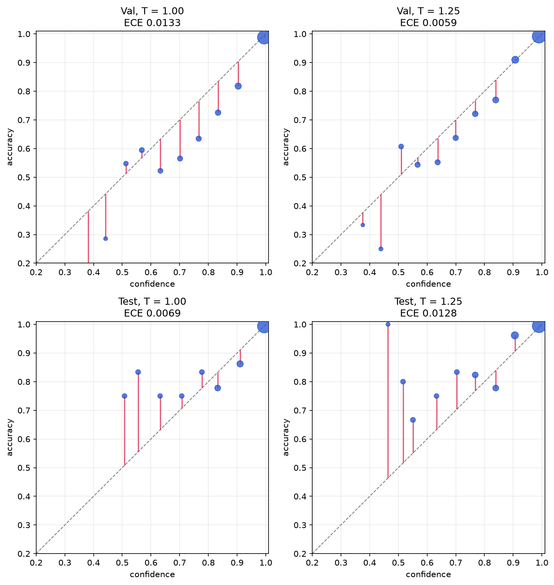

Points below the diagonal are over-confident. On validation, mean confidence is above accuracy and T > 1 moves the points closer to the line. On test, confidence already matches accuracy, and the same T pushes it below accuracy. All four scores move the same way, as does ECE at 5 to 30 bins.

**That pattern isn't established statistically.** The change in ECE, from a patient-level bootstrap ([table](results/step7_calibration_change.csv)):

| | Change in ECE, 95% CI | Resamples where ECE rose |
|---|---:|---:|
| Validation | −0.0120 to +0.0029 | 9% |
| Test | −0.0058 to +0.0116 | 81% |

Both intervals include zero. The supported claim is that there's no evidence T = 1.25 helps on test, and it probably doesn't.

**Why might it not carry over?** Not the class mix: reweighting validation to 25% per class moves T to 1.48, further from the 1.05 test would want (a diagnosis, never used). The different test acquisition (finding 5) is the best-supported explanation so far, but it's a hypothesis.

</details>

<details>
<summary><b>Step 8 · Selective prediction</b>: low confidence does point at the mistakes</summary>

Sort scans by confidence, answer the top ones and flag the rest. Each threshold is chosen on validation, then applied to test. Ranges are patient-level 95% intervals, with the threshold held fixed.

| Target coverage | Test answered | Accuracy answered | Accuracy flagged | Errors caught, test | Errors caught, validation |
|---:|---:|---:|---:|---:|---:|
| 95% | 95.8% | 99.0% (98.2–99.6) | 78.6% | 9 of 19 (47%; 24–71) | 205 of 377 (54%) |
| **90%** | **90.9%** | **99.3% (98.6–99.9)** | 85.7% | **13 of 19 (68%; 42–92)** | 282 of 377 (75%) |
| 80% | 80.1% | 99.8% (99.3–100) | 91.5% | 17 of 19 (89%; 72–100) | 326 of 377 (86%) |

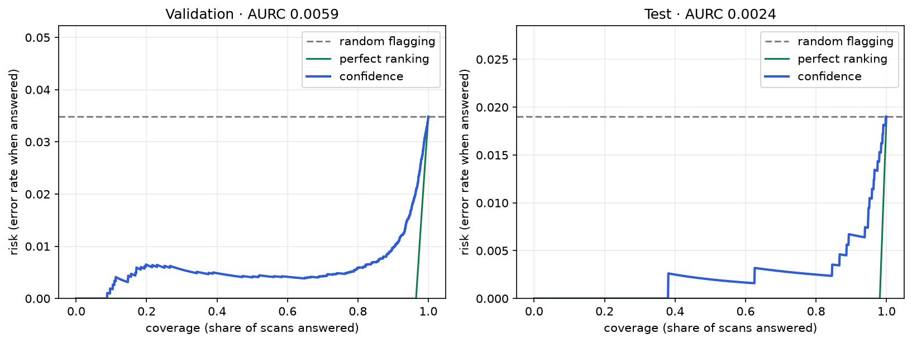

- **Confidence ranks mistakes far better than chance:** test AURC is 0.0024, against 0.0190 for random flagging and 0.0002 for a perfect ranking.
- **The review load is uneven:** at 90%, 23.2% of test DRUSEN scans are flagged, against 2.4–6.0% for the other classes ([table](results/step8_per_class.csv)).
- **Margin and entropy give no clear improvement** over plain confidence ([table](results/step8_score_comparison.csv)).

</details>

<details>
<summary><b>Step 10 · Team of models</b>: a little steadier, but the models share a blind spot</summary>

I trained the same model four more times, changing only the random seed, and averaged the probabilities of all five. Thresholds and temperature come from validation.

| Out of 1,000 test scans | Accuracy | ECE | AURC | NLL | Confident mistakes |
|---|---:|---:|---:|---:|---:|
| Baseline (seed 42) | 98.1% | 0.0069 | 0.0023 | 0.0682 | 6 |
| Temperature scaling (T = 1.25) | 98.1% | 0.0128 | 0.0024 | 0.0703 | 6 |
| Team of 5 | 98.1% | 0.0098 | 0.0020 | 0.0633 | 4 |
| Team of 5 + temperature (T = 1.09) | 98.1% | 0.0098 | 0.0021 | 0.0648 | 4 |

95% range of the change from temperature scaling to team + temperature, by patient:

| | Accuracy | ECE | NLL | AURC |
|---|---:|---:|---:|---:|
| Validation (10,830 scans) | +0.0004 to +0.0055 | −0.0050 to +0.0012 | −0.0202 to −0.0087 | −0.0023 to −0.0005 |
| Test (1,000 scans) | −0.0050 to +0.0049 | −0.0086 to +0.0064 | −0.0117 to +0.0005 | −0.0010 to +0.0001 |

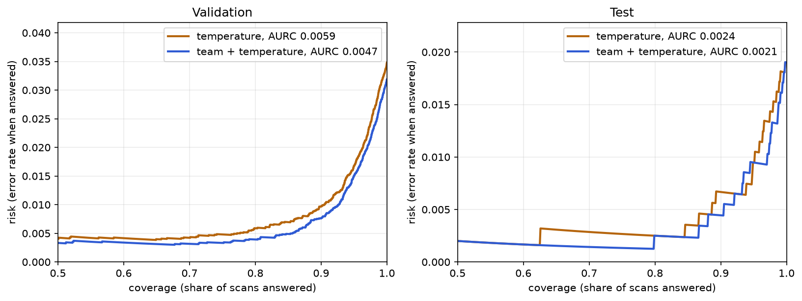

On validation, a team of five gives small but clear gains in accuracy, NLL and AURC over one temperature-scaled model, while on test all the ranges include no change. All 7 confident mistakes across the two methods are made by all five models, so the team doesn't justify five times the training here, and one temperature number stays the headline method.

- **Same mistakes:** the team makes 19 test mistakes, like seed 42. 11 scans are wrong in all five models, and the other 8 are scans where the models disagree and the team picks wrong.
- **Like for like:** flagging the same 91 test scans, the team catches 14 mistakes and the single model 13.
- **Less temperature needed:** on validation, the team's ECE is 0.0055 with no temperature, close to 0.0059 for the single model with it.
- **Team size:** on validation, three models give about 82% of the drop in mistakes that five give ([table](results/step10_team_size.csv)).
- **Why they agree:** not established. Wrong labels, or something all five share such as the data or settings, are untested ideas ([the scans and votes](results/step10_confident_mistakes.csv)).
- Full tables: [comparison](results/step10_comparison.csv), [ranges](results/step10_change.csv), [each seed](results/step10_members.csv).

</details>

## Data

**Kermany, Zhang & Goldbaum (2018), OCT2017, Mendeley Data v3** ([doi:10.17632/rscbjbr9sj.3](https://data.mendeley.com/datasets/rscbjbr9sj/3)), licensed CC BY 4.0. This is the release used in the [*Cell* paper](https://www.cell.com/cell/fulltext/S0092-8674(18)30154-5).

| Split | Scans | Patients | CNV | DME | DRUSEN | NORMAL |
|---|---:|---:|---:|---:|---:|---:|
| train | 97,479 | 4,303 | 33,484 | 10,213 | 7,754 | 46,028 |
| val | 10,830 | 482 | 3,721 | 1,135 | 862 | 5,112 |
| test | 1,000 | 635 | 250 | 250 | 250 | 250 |

Validation is about 10% of the training *patients*, with class shares matched to train. The test set is the official one, balanced at 250 per class, so **macro-F1** is the headline metric rather than accuracy.

### My two Kaggle copies

I made two copies of the data on Kaggle, because the training ran there. Both keep the original licence (CC BY 4.0) and credit the authors.

| Copy | What it is | Why I made it | Size | Who can see it |
|---|---|---|---:|---|
| [Kermany Retinal OCT (Mendeley v3)](https://www.kaggle.com/datasets/zyanislam/kermany-retinal-oct-v3) | The OCT part of Mendeley v3, unchanged | The popular Kaggle copy is the older v2 ([finding 1](#the-data-and-how-to-test-fairly)) | 7.2 GB | Private for now |
| [Kermany Retinal OCT v3, 256x256](https://www.kaggle.com/datasets/zyanislam/kermany-retinal-oct-v3-256) | The same 109,309 scans in the same folders with the same file names, each converted to grayscale and resized once to 256×256 (plain bilinear resize, no padding), saved as JPEG at quality 95 | Reading full-size files from Kaggle's disk capped training at about 100 images/s ([finding 6](#the-pipeline)). This copy reached 359–489 | 2.6 GB | Public |

**Every training run and every heatmap used the 256×256 copy.** Keeping the file names means the saved patient split works on both copies. The resize has no padding because padding would leave black bars on every scan except the all-DME 512×512 ones, which would give the model a shortcut. The cost is that wide scans are squashed ([limitations](#limitations)).

<details>
<summary><b>Sample scans: 20 random training scans per class</b></summary>

| CNV | DME |
|---|---|
| 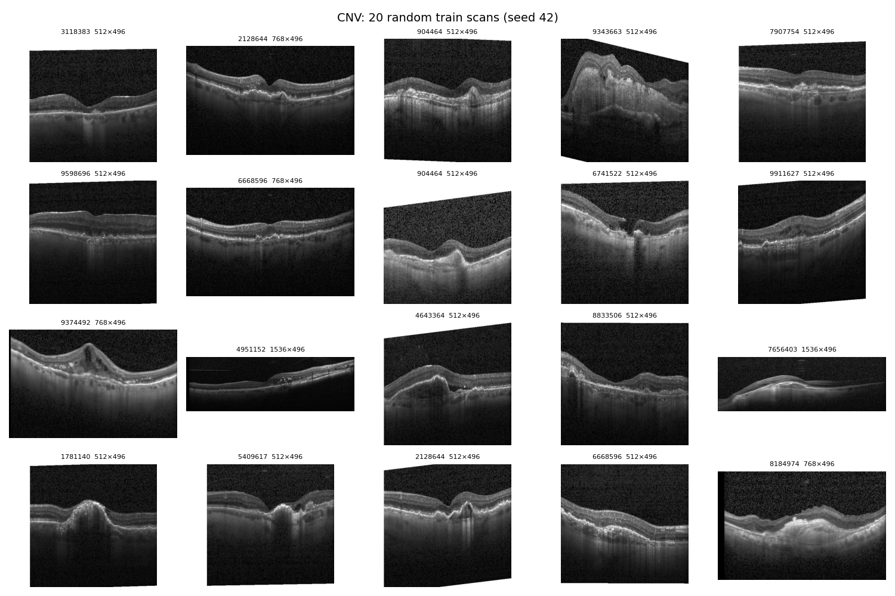 | 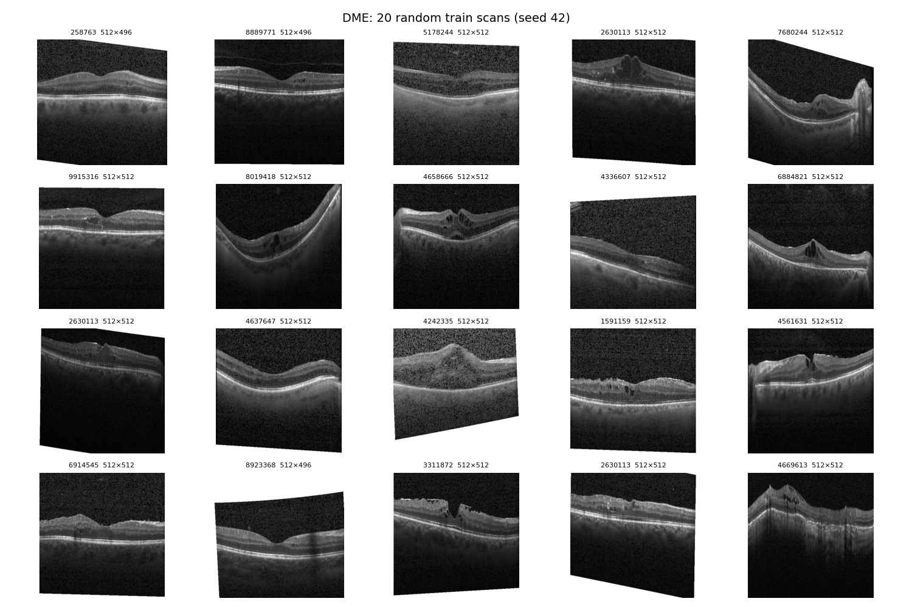 |
| **DRUSEN** | **NORMAL** |
| 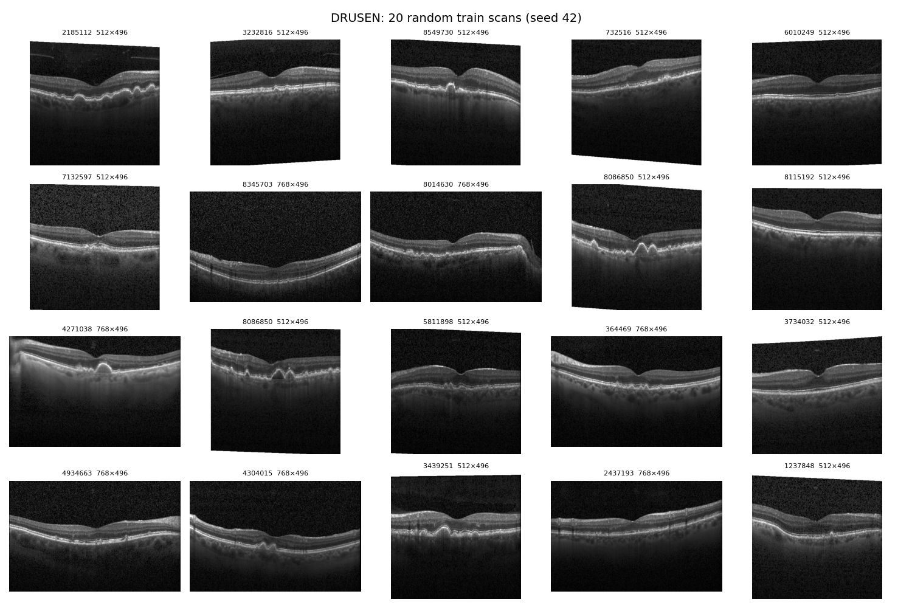 | 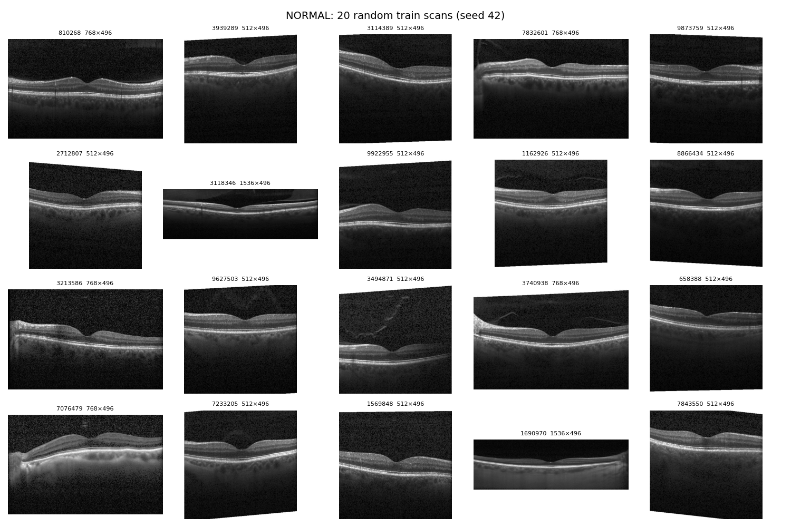 |

</details>

## How the steps fit together

Each step answers one question and hands a file to the next. Training happens once, on a Kaggle GPU (Step 5). Every analysis after it reads the saved logits, so Steps 6–8 run on a laptop in seconds, with no retraining.

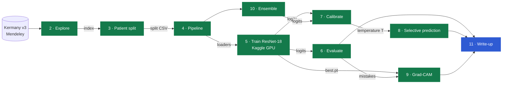

| Step | Question it answers | Needs (from) | Ran on | Uses | Produces | |
|---|---|---|---|---|---|:---:|
| **1 · Workspace** | Where does everything live, reproducibly? | – | Mac, GitHub, Kaggle | git, Kaggle CLI | this repo; the v3 data and a 256×256 copy as Kaggle datasets | ✅ |
| **2 · Explore** | What's in the data, and what could mislead a model? | Kermany v3 | Kaggle notebook, CPU | [`src/data.py`](src/data.py) `build_index` | counts, patients, image sizes ([`results/step2_*`](results/)), sample grids | ✅ |
| **3 · Split** | How do we test without the model recognising patients? | index (2) | Kaggle, CPU; checked on Mac | `patient_split`: `StratifiedGroupKFold` by patient, leakage `assert` | [`splits/oct_split_fold0.csv`](splits/oct_split_fold0.csv), read by every later step | ✅ |
| **4 · Pipeline** | How do scans reach the network, fast and undistorted? | split (3), 256×256 copy (1) | Kaggle, CPU | [`src/dataset.py`](src/dataset.py), torchvision v2 | resize decision, augmentation, loaders at 359–489 images/s ([`results/step4_*`](results/)) | ✅ |
| **5 · Baseline** | Can a standard CNN tell the four classes apart? | loaders (4) | Kaggle, Tesla T4 GPU, 36 min | [`src/model.py`](src/model.py), [`src/train.py`](src/train.py): ImageNet ResNet-18 | `best.pt` and validation/test logits (in `runs/`, not committed), training log | ✅ |
| **6 · Evaluate** | How sure is the score, and what does it confuse? | logits (5); patient IDs (3) | Mac, CPU, 9 s | [`src/evaluate.py`](src/evaluate.py): patient-level bootstrap | intervals, per-class table, confusion matrices ([`results/step6_*`](results/)) | ✅ |
| **7 · Calibrate** | Does "98% sure" mean 98%? | logits (5); patient IDs (3) | Mac, CPU | [`src/calibrate.py`](src/calibrate.py): ECE, reliability diagrams, temperature scaling | T, before/after scores and diagrams ([`results/step7_*`](results/)) | ✅ |
| **8 · Selective prediction** | If it answers only confident scans, how many mistakes does it catch? | calibrated probabilities (7) | Mac, CPU | [`src/selective.py`](src/selective.py): risk–coverage curve, threshold chosen on validation | the headline result, plot and tables ([`results/step8_*`](results/)) | ✅ |
| **9 · Grad-CAM** | What does it look at, especially when confidently wrong? | `best.pt` (5), mistakes (6) | Kaggle or Mac | [`src/gradcam.py`](src/gradcam.py): Grad-CAM, checked against `pytorch-grad-cam` | heatmap panels ([`figures/step9/`](figures/step9/)) | ✅ |
| **10 · Ensemble** | Do five models beat one temperature number? | pipeline (4), training (5) | Kaggle, Tesla T4 GPU, 2 h 19 min; then Mac, CPU | [`src/ensemble.py`](src/ensemble.py): deep ensemble of 5 seeds | comparison table and plot ([`results/step10_*`](results/)) | ✅ |
| **11 · Write-up** | What does it all add up to? | everything | – | – | this README in its final form | ⏳ |

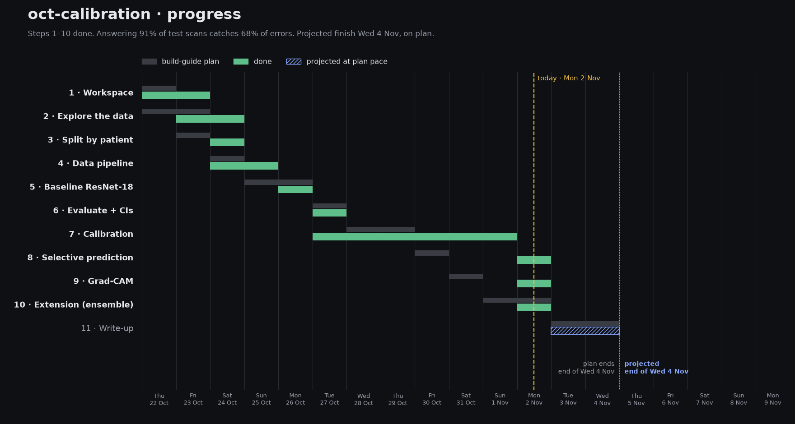

The full plan is in [`docs/OCT-Build-Guide.md`](docs/OCT-Build-Guide.md), and the day-by-day log, with every decision and what went wrong, is in [`NOTES.md`](NOTES.md).

## Repository layout

```
src/        project code
            data.py      index + patient split          (Steps 2–3)
            dataset.py   Dataset, transforms, loaders   (Step 4)
            model.py     ResNet-18 with a 4-class head  (Step 5)
            train.py     training loop and checks       (Step 5)
            evaluate.py  metrics, bootstrap, confusion  (Step 6)
            calibrate.py ECE, temperature, reliability  (Step 7)
            selective.py risk–coverage, thresholds          (Step 8)
            gradcam.py   heatmaps and panels                (Step 9)
            ensemble.py  team of models, comparison table   (Step 10)
logits/     each model's saved outputs on validation and test, enough to rerun Steps 6, 7, 8 and 10
splits/     the saved patient split that every step from 3 on reads
results/    small CSV tables of every result, one file per step (index in results/README.md)
figures/    figures used in NOTES.md and this README, one folder per step
notebooks/  thin Kaggle notebooks that clone the repo and call src/
docs/       build guide and research roadmap
NOTES.md    daily log: what I tried, what broke, what I learned
TODO.md     things deferred until later
runs/       checkpoints, logits and run outputs (gitignored)
```

## References

- Kermany, D. S. et al. (2018). *Identifying Medical Diagnoses and Treatable Diseases by Image-Based Deep Learning.* Cell 172(5).
- Guo, C. et al. (2017). *On Calibration of Modern Neural Networks.* ICML.
- Geifman, Y. & El-Yaniv, R. (2017). *Selective Classification for Deep Neural Networks.* NeurIPS.
- Lakshminarayanan, B., Pritzel, A. & Blundell, C. (2017). *Simple and Scalable Predictive Uncertainty Estimation using Deep Ensembles.* NeurIPS.
- Kapoor, S. & Narayanan, A. (2023). *Leakage and the Reproducibility Crisis in Machine-Learning-Based Science.* Patterns.
