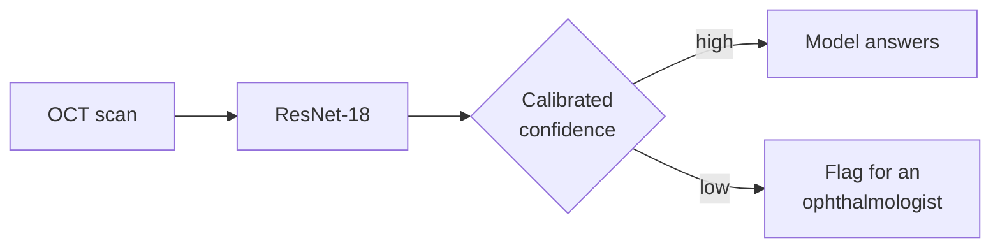
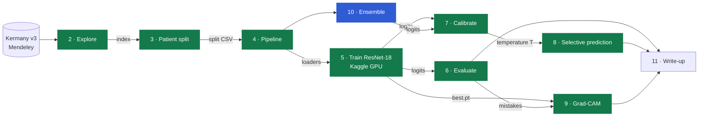
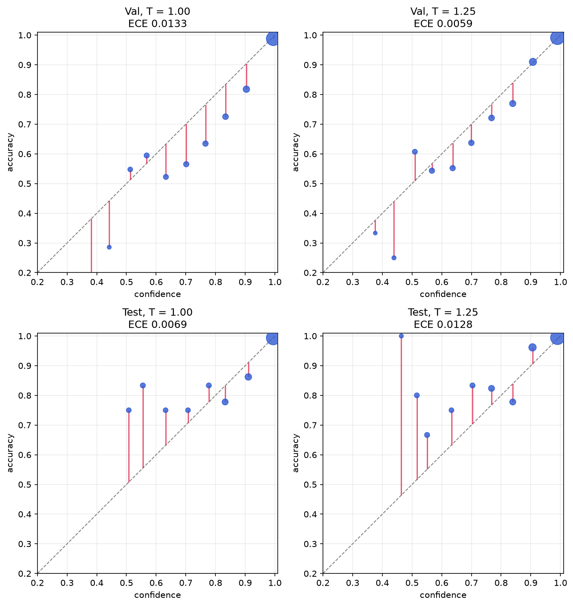
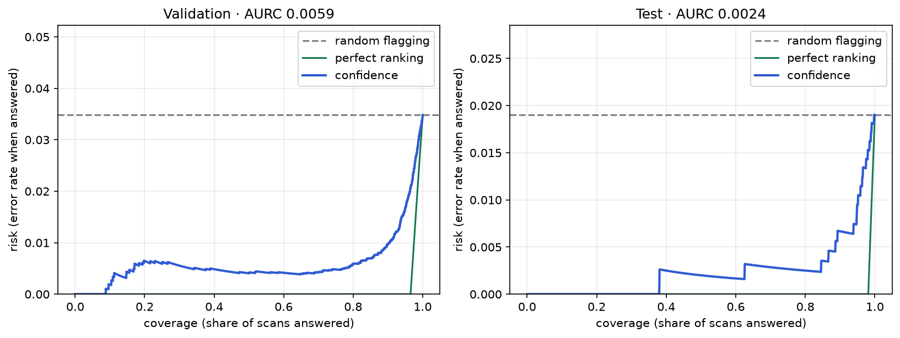
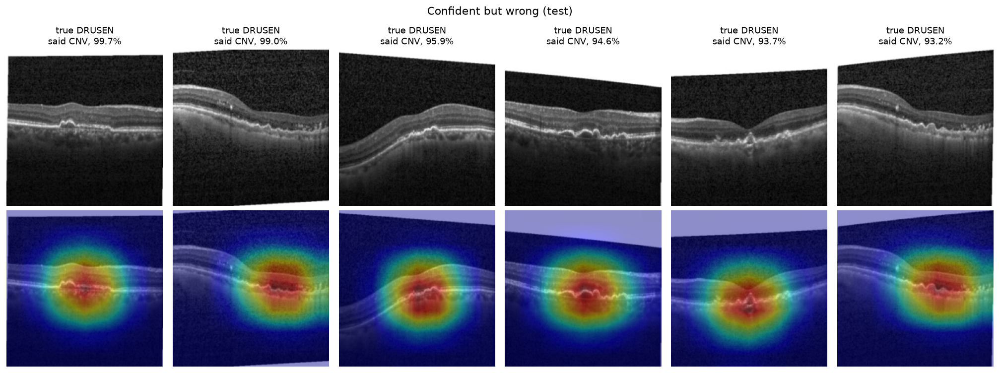

# oct-calibration

**Can an eye-scan AI tell us when not to trust it?**


An AI that's right 98% of the time is still wrong sometimes, and on its own you can't tell which answers are the wrong ones. This project trains a model to read retinal scans, then tests whether it can say "I'm not sure, a doctor should look at this one", and whether that warning means anything.

**The main result: if a doctor checks the 9% of scans the AI is least sure about, about two-thirds of its mistakes get caught.**

| Out of 1,000 test scans | Scans | Mistakes |
|---|---:|---:|
| AI answers everything | 1,000 | 19 |
| AI answers only when confident | 909 | **6** |
| Sent to a doctor | 91 | the other 13 are caught here |

**Two honest limits.** The "two-thirds" rests on only 19 mistakes, so the true figure could be anywhere from about 40% to 90%. And this isn't ready for a clinic: the test scans look different from the training scans, so results on another hospital's scans could differ.



**In plain steps:** get about 109,000 labelled scans → keep each patient on one side of the test → train the model → measure it honestly → check whether its confidence can be trusted → let it pass on the scans it's unsure about.

The technical detail is below. It's the imaging half of a wider question I work on: how to show model uncertainty to the people who rely on it. The other half is confidence cues on automatic captions for Deaf and hard-of-hearing viewers, where an unreliable "I'm unsure" flag is worse than none.

## At a glance

| | Result so far |
|---|---|
| **Classifier** (Step 5) | ImageNet ResNet-18, fine-tuned: validation macro-F1 **0.939** |
| **Test score** (Step 6) | macro-F1 **0.981 (95% CI 0.971–0.990)**, patient-level bootstrap |
| **Main mistake** (Step 6) | DRUSEN read as CNV: 15 of the 19 test errors |
| **Calibration** (Step 7) | Over-confident on validation (confidence 0.978, accuracy 0.965). T = 1.25 lowers validation ECE from 0.0133 to 0.0059, but test ECE rises from 0.0069 to 0.0128; both changes' 95% intervals include zero |
| **Where it looks** (Step 9) | All 6 confident test mistakes are drusen called CNV. Heat is mostly on the retina; no obvious size shortcut in the scans checked, though that isn't ruled out |
| **Selective prediction** (Step 8) | Answering 91% of test scans catches 68% of errors (13 of 19; 95% CI 42–92%), and accuracy on answered scans rises from 98.1% to 99.3% |

## How the steps fit together

Each step answers one question and hands a file to the next. Training happens once, on a Kaggle GPU (Step 5). Every analysis after it reads the saved logits, so Steps 6–8 run on a laptop in seconds, with no retraining.



| Step | Question it answers | Needs (from) | Ran on | Uses | Produces | |
|---|---|---|---|---|---|:---:|
| **1 · Workspace** | Where does everything live, reproducibly? | – | Mac, GitHub, Kaggle | git, Kaggle CLI | this repo; the v3 data and a 256×256 copy as Kaggle datasets | ✅ |
| **2 · Explore** | What's in the data, and what could mislead a model? | Kermany v3 | Kaggle notebook, CPU | [`src/data.py`](src/data.py) `build_index` | counts, patients, image sizes ([`results/step2_*`](results/)), sample grids | ✅ |
| **3 · Split** | How do we test without the model recognising patients? | index (2) | Kaggle, CPU; checked on Mac | `patient_split`: `StratifiedGroupKFold` by patient, leakage `assert` | [`splits/oct_split_fold0.csv`](splits/oct_split_fold0.csv), read by every later step | ✅ |
| **4 · Pipeline** | How do scans reach the network, fast and undistorted? | split (3), 256×256 copy (1) | Kaggle, CPU | [`src/dataset.py`](src/dataset.py), torchvision v2 | resize decision, augmentation, loaders at 359–489 images/s ([`results/step4_*`](results/)) | ✅ |
| **5 · Baseline** | Can a standard CNN tell the four classes apart? | loaders (4) | Kaggle, Tesla T4 GPU, 36 min | [`src/model.py`](src/model.py), [`src/train.py`](src/train.py): ImageNet ResNet-18 | `best.pt` and validation/test logits (in `runs/`, not committed), training log | ✅ |
| **6 · Evaluate** | How sure is the score, and what does it confuse? | logits (5); patient IDs (3) | Mac, CPU, 9 s | [`src/evaluate.py`](src/evaluate.py): patient-level bootstrap | intervals, per-class table, confusion matrices ([`results/step6_*`](results/)) | ✅ |
| **7 · Calibrate** | Does "98% sure" mean 98%? | logits (5); patient IDs (3) | Mac, CPU | [`src/calibrate.py`](src/calibrate.py): ECE, reliability diagrams, temperature scaling | T, before/after scores and diagrams ([`results/step7_*`](results/)) | ✅ |
| **8 · Selective prediction** | If it answers only confident scans, how many mistakes does it catch? | calibrated probabilities (7) | Mac, CPU | [`src/selective.py`](src/selective.py): risk–coverage curve, threshold chosen on validation | the headline result, plot and tables ([`results/step8_*`](results/)) | ✅ |
| **9 · Grad-CAM** | What does it look at, especially when confidently wrong? | `best.pt` (5), mistakes (6) | Kaggle or Mac | [`src/gradcam.py`](src/gradcam.py): Grad-CAM, checked against `pytorch-grad-cam` | heatmap panels ([`figures/step9/`](figures/step9/)) | ✅ |
| **10 · Extension** | Does an ensemble give more honest confidence? | pipeline (4), training (5) | Kaggle GPU | e.g. a deep ensemble | new logits, rerun through 6–8 | ⏳ |
| **11 · Write-up** | What does it all add up to? | everything | – | – | this README in its final form | |


The full plan is in [`docs/OCT-Build-Guide.md`](docs/OCT-Build-Guide.md), and the day-by-day log, with every decision and what went wrong, is in [`NOTES.md`](NOTES.md).

## The four classes

| Class | What it is | What to look for on the scan |
|---|---|---|
| **NORMAL** | Healthy retina | Smooth layers, a clean dip at the centre (the fovea) |
| **DME** | Diabetic macular edema | Dark fluid pockets *inside* a swollen retina; the bottom band (RPE) stays flat |
| **CNV** | Choroidal neovascularization (wet AMD) | The RPE pushed up into an irregular hump by new vessels underneath, often with fluid and a shadow |
| **DRUSEN** | Deposits under the retina (early AMD) | A row of small, smooth, regular bumps on the RPE, with the layers above intact |

Before writing any code, I learned to label these by eye. Over three practice rounds, I went from **3/8 to 6/8 to 8/8** ([notes](NOTES.md)).

## What I've found so far

### The data and how to test fairly

**1. The popular Kaggle copy of this dataset is the old version.** (Step 1) `paultimothymooney/kermany2018` is Mendeley **v2**: 83,484 training scans with only 26,315 NORMAL, 242 test scans per class, and the whole dataset stored twice. The paper used **v3** (108,309 train, 1,000 test). There was no clean v3 copy on Kaggle, so I uploaded my own.

**2. Patients, not scans, are the unit that matters.** (Steps 2–3) One patient contributes up to 813 training scans, and 787 patients have scans in more than one class. If you split by image, the model can score well by recognising a patient's eye rather than the disease. Every split here keeps each patient on one side, and an `assert` checks it.

**3. A fixed random seed didn't make the split reproducible.** (Step 3) The same code with `seed=42` gave a different validation set on Kaggle than on my laptop: only 44 of 473 validation patients were the same. The cause was a change in scikit-learn's `StratifiedGroupKFold` between versions. Kaggle's split was also badly balanced:

| Validation set | CNV | DME | DRUSEN | NORMAL |
|---|---:|---:|---:|---:|
| Training set (target) | 34.4% | 10.5% | 8.0% | 47.2% |
| Shuffled split, Kaggle's scikit-learn | **42.5%** | 8.0% | **6.6%** | 42.9% |
| Fixed split, `shuffle=False` | 34.4% | 10.5% | 8.0% | 47.2% |

The fix gives an identical split on scikit-learn 1.6, 1.7 and 1.9, and the split is saved as a file that every later step reads ([comparison](results/step3_split_comparison.csv)).

**4. The scans aren't one size, and one size gives away a class.** (Steps 2 and 4) There are 8 image sizes, from 512×512 to 1536×496 ([table](results/step2_image_sizes.csv)). **Every 512×512 scan is DME**: 8,659 scans, about 75% of all DME ([table](results/step4_size_by_class.csv)). They probably come from a different scanner or clinic, so a model could learn the scanner instead of the disease. That decided the resize: a plain resize to 224×224, because padding to a square would leave black bars on every scan except those DME ones. Grad-CAM in Step 9 found no obvious sign of the shortcut in the scans checked, which doesn't rule it out.


**5. The official test set looks like a different acquisition.** (Step 7) 94% of test scans are 1024×496, a size that is only 0.4% of the training and validation scans ([table](results/step7_size_by_split.csv)). Test scans are also more accurately classified in every class. So test scores and test calibration describe one particular population, not "OCT scans in general". Test also has no 512×512 scans, so the DME shortcut (finding 4) can't inflate test scores. I only noticed this in Step 7, because image sizes had been compared by class but never by split. Whether acquisition is what causes the higher accuracy isn't established: the 44 validation scans at 1024×496 are less accurate (0.909).

### The pipeline

**6. Loading the data was the first bottleneck, not the model.** (Step 4) Reading scans straight from Kaggle's input disk gave about 100 images/s, because the disk waits on the first read of every file. Resizing every scan once to 256×256 and copying them to local disk at the start of each session (about 65 s) raised it to **359–489 images/s**: about 3–4 minutes of loading per epoch instead of 15 ([numbers](results/step4_loader_speed.csv)).

**7. Almost every scan is grayscale.** (Step 4) 109,307 of 109,309 are single-channel; the two RGB exceptions are drusen test scans at one-off sizes ([table](results/step4_image_modes.csv)). The pipeline reads every scan as grayscale and copies it to the 3 channels the pretrained network expects.

## Results by step

<details open>
<summary><b>Step 5 · Baseline</b>: validation macro-F1 0.939</summary>

ImageNet-pretrained ResNet-18, all layers fine-tuned, class-weighted loss, AdamW with cosine warm-up, mixed precision, 8 epochs, seed 42, one Tesla T4 (36 min). A clean rerun gave bit-identical logits.

| | Accuracy | Macro-F1 |
|---|---:|---:|
| Validation (10,830 scans, real class mix) | 0.965 | **0.939** |
| Test (1,000 scans, balanced) | 0.981 | 0.981 |


The weakest class is DRUSEN (validation F1 0.86), mostly confused with CNV ([per class](results/step5_per_class.csv)).

</details>

<details open>
<summary><b>Step 6 · Evaluation</b>: test macro-F1 0.981 (95% CI 0.971–0.990)</summary>

95% intervals from 1,000 bootstrap resamples of the test set. The headline resamples **patients** (the 1,000 test scans come from 635 patients, and scans of one eye aren't independent); resampling images gives a slightly narrower interval.

| Test set | Value | 95% CI, by patient | 95% CI, by image | Validation |
|---|---:|---:|---:|---:|
| Accuracy | 0.981 | 0.971–0.990 | 0.972–0.989 | 0.965 |
| Macro-F1 | **0.981** | **0.971–0.990** | 0.972–0.989 | 0.939 |

| Class | Recall (95% CI) | F1 (95% CI) | Precision | AUC |
|---|---:|---:|---:|---:|
| CNV | 0.992 (0.980–1.000) | 0.967 (0.947–0.984) | 0.943 | 0.999 |
| DME | 1.000 | 0.996 (0.989–1.000) | 0.992 | 1.000 |
| DRUSEN | **0.940 (0.904–0.969)** | 0.965 (0.945–0.982) | 0.992 | 0.997 |
| NORMAL | 0.992 (0.979–1.000) | 0.996 (0.989–1.000) | 1.000 | 1.000 |


**The main confusion is DRUSEN read as CNV: 15 of the 19 test mistakes.** Likely because both raise the RPE, and what separates them is subtle (a hypothesis; Step 9's heatmaps fit it but can't prove it). Drusen are small, smooth, regular bumps under intact layers, while CNV is an irregular hump, often with fluid above it. It's the same distinction I got wrong in my first two labelling rounds.

Four things the table doesn't show on its own:
- **The balanced test set hides a second weak spot.** On validation (real class mix), 86 of 1,135 DME scans (7.6%) were called NORMAL; on test, none were ([confusion matrix](figures/step6/confusion_val.png)).
- **DME recall has no bootstrap interval.** With zero misses, no resample contains one. By the rule of three, 0 misses in 250 still means recall is at least about 0.988 with 95% confidence.
- **The intervals cover sampling noise within this test set only.** Test is almost all one image size that training barely contains (finding 5), so they don't say how the model does on another scanner.
- **Precision and AUC get point values only.** Precision depends on class prevalence, which the balanced test set fixes at 25%; AUC is at its ceiling.

</details>

<details open>
<summary><b>Step 7 · Calibration</b>: over-confident on validation; T = 1.25 doesn't clearly carry over to test</summary>

T is fitted on validation only. Scaling never changes a prediction, and the code asserts this. Equal-width ECE with 15 bins is the headline ([table](results/step7_calibration.csv)).

| | Mean confidence | Accuracy | ECE | ECE, equal-mass | NLL | Brier |
|---|---:|---:|---:|---:|---:|---:|
| Validation, before | 0.978 | 0.965 | 0.0133 | 0.0127 | 0.1142 | 0.0544 |
| Validation, T = 1.25 | 0.967 | 0.965 | **0.0059** | 0.0075 | 0.1088 | 0.0533 |
| Test, before | 0.981 | 0.981 | **0.0069** | 0.0043 | 0.0682 | 0.0342 |
| Test, T = 1.25 | 0.970 | 0.981 | 0.0128 | 0.0128 | 0.0703 | 0.0346 |



Points below the diagonal are over-confident. On validation, mean confidence is above accuracy and T > 1 moves the points closer to the line. On test, confidence already matches accuracy, and the same T pushes it below accuracy. All four scores move the same way, as does ECE at 5 to 30 bins.

**That pattern isn't established statistically.** The change in ECE, from a patient-level bootstrap ([table](results/step7_calibration_change.csv)):

| | Change in ECE, 95% CI | Resamples where ECE rose |
|---|---:|---:|
| Validation | −0.0120 to +0.0029 | 9% |
| Test | −0.0058 to +0.0116 | 81% |

Both intervals include zero. The supported claim is that there's no evidence T = 1.25 helps on test, and it probably doesn't.

**Why might it not carry over?** Not the class mix: reweighting validation to 25% per class moves T to 1.48, further from the 1.05 test would want (a diagnosis, never used). The different test acquisition (finding 5) is the best-supported explanation so far, but it's a hypothesis.

</details>

<details open>
<summary><b>Step 8 · Selective prediction</b>: low confidence does point at the mistakes</summary>

Sort scans by confidence, answer the top ones and flag the rest. Each threshold is chosen on validation, then applied to test. Ranges are patient-level 95% intervals, with the threshold held fixed.

| Target coverage | Test answered | Accuracy answered | Accuracy flagged | Errors caught, test | Errors caught, validation |
|---:|---:|---:|---:|---:|---:|
| 95% | 95.8% | 99.0% (98.2–99.6) | 78.6% | 9 of 19 (47%; 24–71) | 205 of 377 (54%) |
| **90%** | **90.9%** | **99.3% (98.6–99.9)** | 85.7% | **13 of 19 (68%; 42–92)** | 282 of 377 (75%) |
| 80% | 80.1% | 99.8% (99.3–100) | 91.5% | 17 of 19 (89%; 72–100) | 326 of 377 (86%) |



- **Confidence ranks mistakes far better than chance:** test AURC is 0.0024, against 0.0190 for random flagging and 0.0002 for a perfect ranking.
- **The review load is uneven:** at 90%, 23.2% of test DRUSEN scans are flagged, against 2.4–6.0% for the other classes ([table](results/step8_per_class.csv)).
- **Margin and entropy give no clear improvement** over plain confidence ([table](results/step8_score_comparison.csv)).

</details>

<details open>
<summary><b>Step 9 · Grad-CAM</b>: where the model looked</summary>

Heatmaps show which regions most influenced an answer. They show where the model looked, not why it was right.



- **Measured:** test has exactly 6 mistakes above the confidence threshold. All 6 are drusen called CNV, from 5 patients. A doctor wouldn't be shown these.
- **Confident mistakes:** all have bumps along the RPE, often several and uneven, with heat on them. A hypothesis is that uneven drusen resemble the irregular CNV hump. Six scans can't prove it, and other bumpy drusen weren't confident mistakes.
- **Size shortcut:** in [six 512×512 DME scans](figures/step9/dme_512.png), heat is on fluid where it's visible, not on corners or borders. That shows no obvious shortcut there but can't rule one out.
- **Other panels:** [confident and right](figures/step9/confident_right.png), [least confident](figures/step9/least_confident.png). Scans shown are [listed here](results/step9_scans_shown.csv).
- **Caution:** the heat is nearly always a central blob on coarse 7×7 maps, and the retina usually sits in the middle, so "on the retina" may be partly a centring effect.

</details>

## Data

**Kermany, Zhang & Goldbaum (2018), OCT2017, Mendeley Data v3** ([doi:10.17632/rscbjbr9sj.3](https://data.mendeley.com/datasets/rscbjbr9sj/3)), licensed CC BY 4.0. This is the release used in the [*Cell* paper](https://www.cell.com/cell/fulltext/S0092-8674(18)30154-5).

| Split | Scans | Patients | CNV | DME | DRUSEN | NORMAL |
|---|---:|---:|---:|---:|---:|---:|
| train | 97,479 | 4,303 | 33,484 | 10,213 | 7,754 | 46,028 |
| val | 10,830 | 482 | 3,721 | 1,135 | 862 | 5,112 |
| test | 1,000 | 635 | 250 | 250 | 250 | 250 |

Validation is about 10% of the training *patients*, with class shares matched to train. The test set is the official one, balanced at 250 per class, so **macro-F1** is the headline metric rather than accuracy.

<details>
<summary><b>Sample scans: 20 random training scans per class</b></summary>

| CNV | DME |
|---|---|
|  |  |
| **DRUSEN** | **NORMAL** |
|  |  |

</details>

## Repository layout

```
src/        project code
            data.py      index + patient split          (Steps 2–3)
            dataset.py   Dataset, transforms, loaders   (Step 4)
            model.py     ResNet-18 with a 4-class head  (Step 5)
            train.py     training loop and checks       (Step 5)
            evaluate.py  metrics, bootstrap, confusion  (Step 6)
            calibrate.py ECE, temperature, reliability  (Step 7)
            selective.py risk–coverage, thresholds          (Step 8)
            gradcam.py   heatmaps and panels                (Step 9)
splits/     the saved patient split that every step from 3 on reads
results/    small CSV tables of every result, one file per step (index in results/README.md)
figures/    figures used in NOTES.md and this README, one folder per step
notebooks/  thin Kaggle notebooks that clone the repo and call src/
docs/       build guide and research roadmap
NOTES.md    daily log: what I tried, what broke, what I learned
TODO.md     things deferred until later
runs/       checkpoints, logits and run outputs (gitignored)
```

## Reproducing

**Steps 2–5 run on Kaggle** with the v3 dataset (or its 256×256 copy) attached, and work the same on a local copy:

```python
from src.data import build_index, patient_split

index, problems = build_index("path/to/OCT")   # Step 2: expects train/ and test/ with one folder per class
split, removed = patient_split(index, fold=0)  # Step 3: same split as splits/oct_split_fold0.csv

from src.dataset import make_loaders
from src.model import build_model
from src.train import class_weights, fit, set_seed

loaders = make_loaders("path/to/OCT")          # Step 4: reads splits/oct_split_fold0.csv
set_seed(42)                                   # Step 5: needs a GPU (about 36 min on a T4)
fit(build_model(), loaders, "runs/step5_baseline", epochs=8,
    weights=class_weights(loaders["train"].dataset.labels))
```

The training notebook is [`notebooks/04_baseline.ipynb`](notebooks/04_baseline.ipynb).

**Steps 6 onwards run on a laptop** from the saved logits in `runs/step5_baseline/`:

```python
from src.evaluate import evaluate_run

summary, per_class = evaluate_run("runs/step5_baseline")   # Step 6, CPU, about 9 s

from src.calibrate import calibrate_run

T, table = calibrate_run("runs/step5_baseline", "figures/step7/reliability.png")   # Step 7, CPU

from src.selective import selective_run

tables = selective_run("runs/step5_baseline", "figures/step8/risk_coverage.png")   # Step 8, CPU

from src.gradcam import gradcam_run

shown = gradcam_run("runs/step5_baseline", "path/to/OCT256", "figures/step9")   # Step 9, CPU, 256×256 scans
```


## References

- Kermany, D. S. et al. (2018). *Identifying Medical Diagnoses and Treatable Diseases by Image-Based Deep Learning.* Cell 172(5).
- Guo, C. et al. (2017). *On Calibration of Modern Neural Networks.* ICML.
- Geifman, Y. & El-Yaniv, R. (2017). *Selective Classification for Deep Neural Networks.* NeurIPS.
- Kapoor, S. & Narayanan, A. (2023). *Leakage and the Reproducibility Crisis in Machine-Learning-Based Science.* Patterns.
