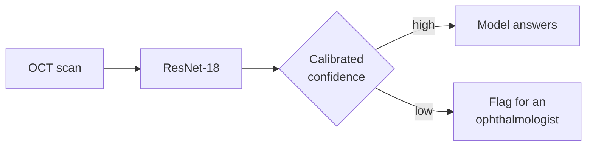

# oct-calibration

**When a retinal-scan classifier says it's unsure, is it actually more likely to be wrong?**


Optical coherence tomography (OCT) gives a cross-section of the retina, and a deep network can sort these scans into four classes with high accuracy. Accuracy alone doesn't make a model safe to use, though. A clinic needs to know **which answers to trust**.

This project builds that classifier and then asks the harder question. If the model answers only the scans it's confident about and sends the rest to an ophthalmologist, **does it catch its own mistakes?**



It's the imaging half of a wider question I work on: how to show model uncertainty to the people who rely on it. The other half is confidence cues on automatic captions for Deaf and hard-of-hearing viewers, where an unreliable "I'm unsure" flag is worse than none.

> **Work in progress.** Steps 1–3 are done; there's no trained model yet. When Step 8 is done, this README will open with one sentence: *"If the model answers X% of scans and flags the rest, it catches Y% of its own mistakes."*

## The four classes

| Class | What it is | What to look for on the scan |
|---|---|---|
| **NORMAL** | Healthy retina | Smooth layers, a clean dip at the centre (the fovea) |
| **DME** | Diabetic macular edema | Dark fluid pockets *inside* a swollen retina; the bottom band (RPE) stays flat |
| **CNV** | Choroidal neovascularization (wet AMD) | The RPE pushed up into an irregular hump by new vessels underneath, often with fluid and a shadow |
| **DRUSEN** | Deposits under the retina (early AMD) | A row of small, smooth, regular bumps on the RPE, with the layers above intact |

Before writing any code, I learned to label these by eye. Over three practice rounds, I went from **3/8 to 6/8 to 8/8** ([notes](NOTES.md)).

## What I've found so far

**1. The popular Kaggle copy of this dataset is the old version.** `paultimothymooney/kermany2018` is Mendeley **v2**: 83,484 training scans with only 26,315 NORMAL, 242 test scans per class, and the whole dataset stored twice. The paper used **v3** (108,309 train, 1,000 test). There was no clean v3 copy on Kaggle, so I uploaded my own.

**2. A fixed random seed didn't make the split reproducible.** The same code with `seed=42` gave a different validation set on Kaggle than on my laptop: only 44 of 473 validation patients were the same. The cause was a change in scikit-learn's `StratifiedGroupKFold` between versions. Kaggle's split was also badly balanced:

| Validation set | CNV | DME | DRUSEN | NORMAL |
|---|---:|---:|---:|---:|
| Training set (target) | 34.4% | 10.5% | 8.0% | 47.2% |
| Shuffled split, Kaggle's scikit-learn | **42.5%** | 8.0% | **6.6%** | 42.9% |
| Fixed split, `shuffle=False` | 34.4% | 10.5% | 8.0% | 47.2% |

The fix gives an identical split on scikit-learn 1.6, 1.7 and 1.9, and the split is saved as a file that every later step reads ([comparison](results/step3_split_comparison.csv)).

**3. Patients, not scans, are the unit that matters.** One patient contributes up to 813 training scans, and 787 patients have scans in more than one class. If you split by image, the model can score well by recognising a patient's eye rather than the disease. Every split here keeps each patient on one side, and an `assert` checks it.

**4. The scans aren't one size.** There are 8 image sizes, from 512×512 to 1536×496 ([table](results/step2_image_sizes.csv)), so resizing is a real design choice rather than a default.

## Progress

| | Step | Status |
|---:|---|:---:|
| 1 | Workspace: repo, Kaggle notebook, dataset access | ✅ |
| 2 | Explore the data: counts, patients, image sizes | ✅ |
| 3 | Split by patient, with a leakage check | ✅ |
| 4 | Data pipeline and augmentation | ⏳ |
| 5 | Baseline: ImageNet-pretrained ResNet-18 | |
| 6 | Evaluation with bootstrap confidence intervals | |
| 7 | Calibration: ECE, reliability diagrams, temperature scaling | |
| 8 | Selective prediction: risk–coverage curve | |
| 9 | Grad-CAM on confident mistakes | |
| 10 | One extension, e.g. a deep ensemble | |
| 11 | Write-up | |

The full plan is in [`docs/OCT-Build-Guide.md`](docs/OCT-Build-Guide.md), and the day-by-day log is in [`NOTES.md`](NOTES.md).

## Data

**Kermany, Zhang & Goldbaum (2018), OCT2017, Mendeley Data v3** ([doi:10.17632/rscbjbr9sj.3](https://data.mendeley.com/datasets/rscbjbr9sj/3)), licensed CC BY 4.0. This is the release used in the [*Cell* paper](https://www.cell.com/cell/fulltext/S0092-8674(18)30154-5).

| Split | Scans | Patients | CNV | DME | DRUSEN | NORMAL |
|---|---:|---:|---:|---:|---:|---:|
| train | 97,479 | 4,303 | 33,484 | 10,213 | 7,754 | 46,028 |
| val | 10,830 | 482 | 3,721 | 1,135 | 862 | 5,112 |
| test | 1,000 | 635 | 250 | 250 | 250 | 250 |

Validation is about 10% of the training *patients*, with class shares matched to train. The test set is the official one, balanced at 250 per class, so **macro-F1** is the headline metric rather than accuracy.

<details>
<summary><b>Sample scans: 20 random training scans per class</b></summary>

| CNV | DME |
|---|---|
|  |  |
| **DRUSEN** | **NORMAL** |
|  |  |

</details>

## Repository layout

```
src/        project code: data.py (index + patient split); more as steps land
splits/     the saved patient split that every step from 3 on reads
results/    small CSV tables of every result, one file per step
figures/    figures used in NOTES.md and this README
notebooks/  thin Kaggle notebooks that clone the repo and call src/
docs/       build guide and research roadmap
NOTES.md    daily log: what I tried, what broke, what I learned
TODO.md     things deferred until later
runs/       checkpoints, logits and run outputs (gitignored)
```

## Reproducing

The code runs in a Kaggle notebook with the v3 dataset attached, and works the same on a local copy.

```python
from src.data import build_index, patient_split

index, problems = build_index("path/to/OCT")   # expects train/ and test/ with one folder per class
split, removed = patient_split(index, fold=0)  # same split as splits/oct_split_fold0.csv
```

Training and evaluation commands will be added as Steps 4–8 land.

## References

- Kermany, D. S. et al. (2018). *Identifying Medical Diagnoses and Treatable Diseases by Image-Based Deep Learning.* Cell 172(5).
- Guo, C. et al. (2017). *On Calibration of Modern Neural Networks.* ICML.
- Geifman, Y. & El-Yaniv, R. (2017). *Selective Classification for Deep Neural Networks.* NeurIPS.
- Kapoor, S. & Narayanan, A. (2023). *Leakage and the Reproducibility Crisis in Machine-Learning-Based Science.* Patterns.
