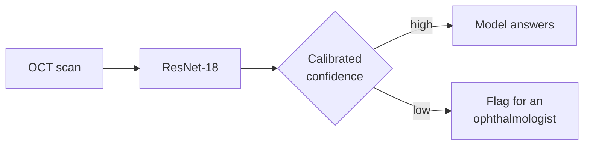

# oct-calibration

**When a retinal-scan classifier says it's unsure, is it actually more likely to be wrong?**


Optical coherence tomography (OCT) gives a cross-section of the retina, and a deep network can sort these scans into four classes with high accuracy. Accuracy alone doesn't make a model safe to use, though. A clinic needs to know **which answers to trust**.

This project builds that classifier and then asks the harder question. If the model answers only the scans it's confident about and sends the rest to an ophthalmologist, **does it catch its own mistakes?**



It's the imaging half of a wider question I work on: how to show model uncertainty to the people who rely on it. The other half is confidence cues on automatic captions for Deaf and hard-of-hearing viewers, where an unreliable "I'm unsure" flag is worse than none.

> **Work in progress.** Steps 1–6 are done. The baseline ResNet-18 reaches **0.981 test macro-F1 (95% CI 0.971–0.990)** and 0.939 on validation; calibration and selective prediction come next. When Step 8 is done, this README will open with one sentence: *"If the model answers X% of scans and flags the rest, it catches Y% of its own mistakes."*

## The four classes

| Class | What it is | What to look for on the scan |
|---|---|---|
| **NORMAL** | Healthy retina | Smooth layers, a clean dip at the centre (the fovea) |
| **DME** | Diabetic macular edema | Dark fluid pockets *inside* a swollen retina; the bottom band (RPE) stays flat |
| **CNV** | Choroidal neovascularization (wet AMD) | The RPE pushed up into an irregular hump by new vessels underneath, often with fluid and a shadow |
| **DRUSEN** | Deposits under the retina (early AMD) | A row of small, smooth, regular bumps on the RPE, with the layers above intact |

Before writing any code, I learned to label these by eye. Over three practice rounds, I went from **3/8 to 6/8 to 8/8** ([notes](NOTES.md)).

## What I've found so far

**1. The popular Kaggle copy of this dataset is the old version.** `paultimothymooney/kermany2018` is Mendeley **v2**: 83,484 training scans with only 26,315 NORMAL, 242 test scans per class, and the whole dataset stored twice. The paper used **v3** (108,309 train, 1,000 test). There was no clean v3 copy on Kaggle, so I uploaded my own.

**2. A fixed random seed didn't make the split reproducible.** The same code with `seed=42` gave a different validation set on Kaggle than on my laptop: only 44 of 473 validation patients were the same. The cause was a change in scikit-learn's `StratifiedGroupKFold` between versions. Kaggle's split was also badly balanced:

| Validation set | CNV | DME | DRUSEN | NORMAL |
|---|---:|---:|---:|---:|
| Training set (target) | 34.4% | 10.5% | 8.0% | 47.2% |
| Shuffled split, Kaggle's scikit-learn | **42.5%** | 8.0% | **6.6%** | 42.9% |
| Fixed split, `shuffle=False` | 34.4% | 10.5% | 8.0% | 47.2% |

The fix gives an identical split on scikit-learn 1.6, 1.7 and 1.9, and the split is saved as a file that every later step reads ([comparison](results/step3_split_comparison.csv)).

**3. Patients, not scans, are the unit that matters.** One patient contributes up to 813 training scans, and 787 patients have scans in more than one class. If you split by image, the model can score well by recognising a patient's eye rather than the disease. Every split here keeps each patient on one side, and an `assert` checks it.

**4. The scans aren't one size, and one size gives away a class.** There are 8 image sizes, from 512×512 to 1536×496 ([table](results/step2_image_sizes.csv)). **Every 512×512 scan is DME**: 8,659 scans, about 75% of all DME ([table](results/step4_size_by_class.csv)). They probably come from a different scanner or clinic, so a model could learn the scanner instead of the disease. That decided the resize: a plain resize to 224×224, because padding to a square would leave black bars on every scan except those DME ones. Grad-CAM in Step 9 checks whether the model takes the shortcut anyway.


**5. Loading the data was the first bottleneck, not the model.** Reading scans straight from Kaggle's input disk gave about 100 images/s, because the disk waits on the first read of every file. Resizing every scan once to 256×256 and copying them to local disk at the start of each session (about 65 s) raised it to **359–489 images/s**: about 3–4 minutes of loading per epoch instead of 15 ([numbers](results/step4_loader_speed.csv)).

**6. Almost every scan is grayscale.** 109,307 of 109,309 are single-channel; the two RGB exceptions are drusen test scans at one-off sizes ([table](results/step4_image_modes.csv)). The pipeline reads every scan as grayscale and copies it to the 3 channels the pretrained network expects.

**7. The official test set looks like a different acquisition.** 94% of test scans are 1024×496, a size that is only 0.4% of the training and validation scans ([table](results/step7_size_by_split.csv)). Test scans are also easier in every class. So test scores and test calibration describe one particular population, not "OCT scans in general". It also means the 512×512 DME shortcut (finding 4) can't inflate test scores: test has no 512×512 scans. I only noticed this in Step 7, because image sizes had been compared by class but never by split.

## Baseline (Step 5)

ImageNet-pretrained ResNet-18, all layers fine-tuned, class-weighted loss, AdamW with cosine warm-up, mixed precision, 8 epochs, seed 42, one Tesla T4 (36 min).

| | Accuracy | Macro-F1 |
|---|---:|---:|
| Validation (10,830 scans, real class mix) | 0.965 | **0.939** |
| Test (1,000 scans, balanced) | 0.981 | 0.981 |


The weakest class is DRUSEN (validation F1 0.86), mostly confused with CNV ([per class](results/step5_per_class.csv)).

## Evaluation (Step 6)

95% intervals from 1,000 bootstrap resamples of the test set. The headline resamples **patients** (the 1,000 test scans come from 635 patients, and scans of one eye aren't independent); resampling images gives a slightly narrower interval.

| Test set | Value | 95% CI, by patient | 95% CI, by image | Validation |
|---|---:|---:|---:|---:|
| Accuracy | 0.981 | 0.971–0.990 | 0.972–0.989 | 0.965 |
| Macro-F1 | **0.981** | **0.971–0.990** | 0.972–0.989 | 0.939 |

| Class | Recall (95% CI) | F1 (95% CI) | Precision | AUC |
|---|---:|---:|---:|---:|
| CNV | 0.992 (0.980–1.000) | 0.967 (0.947–0.984) | 0.943 | 0.999 |
| DME | 1.000 | 0.996 (0.989–1.000) | 0.992 | 1.000 |
| DRUSEN | **0.940 (0.904–0.969)** | 0.965 (0.945–0.982) | 0.992 | 0.997 |
| NORMAL | 0.992 (0.979–1.000) | 0.996 (0.989–1.000) | 1.000 | 1.000 |


**The main confusion is DRUSEN read as CNV: 15 of the 19 test mistakes.** Likely because both raise the RPE, and what separates them is subtle (a hypothesis that Grad-CAM in Step 9 can test). Drusen are small, smooth, regular bumps under intact layers, while CNV is an irregular hump, often with fluid above it. It's the same distinction I got wrong in my first two labelling rounds.

Four things the table doesn't show on its own:
- **The balanced test set hides a second weak spot.** On validation (real class mix), 86 of 1,135 DME scans (7.6%) were called NORMAL; on test, none were ([confusion matrix](figures/step6/confusion_val.png)).
- **DME recall has no bootstrap interval.** With zero misses, no resample contains one. By the rule of three, 0 misses in 250 still means recall is at least about 0.988 with 95% confidence.
- **The intervals cover sampling noise within this test set only.** Test is almost all one image size that training barely contains (finding 7), so they don't say how the model does on another scanner.
- **Precision and AUC get point values only.** Precision depends on class prevalence, which the balanced test set fixes at 25%; AUC is at its ceiling.

Reproduce: `from src.evaluate import evaluate_run; evaluate_run("runs/step5_baseline")` (CPU, about 9 s).

## Progress

| | Step | Status |
|---:|---|:---:|
| 1 | Workspace: repo, Kaggle notebook, dataset access | ✅ |
| 2 | Explore the data: counts, patients, image sizes | ✅ |
| 3 | Split by patient, with a leakage check | ✅ |
| 4 | Data pipeline and augmentation | ✅ |
| 5 | Baseline: ImageNet-pretrained ResNet-18 | ✅ |
| 6 | Evaluation with bootstrap confidence intervals | ✅ |
| 7 | Calibration: ECE, reliability diagrams, temperature scaling | ⏳ |
| 8 | Selective prediction: risk–coverage curve | |
| 9 | Grad-CAM on confident mistakes | |
| 10 | One extension, e.g. a deep ensemble | |
| 11 | Write-up | |


The full plan is in [`docs/OCT-Build-Guide.md`](docs/OCT-Build-Guide.md), and the day-by-day log is in [`NOTES.md`](NOTES.md).

## Data

**Kermany, Zhang & Goldbaum (2018), OCT2017, Mendeley Data v3** ([doi:10.17632/rscbjbr9sj.3](https://data.mendeley.com/datasets/rscbjbr9sj/3)), licensed CC BY 4.0. This is the release used in the [*Cell* paper](https://www.cell.com/cell/fulltext/S0092-8674(18)30154-5).

| Split | Scans | Patients | CNV | DME | DRUSEN | NORMAL |
|---|---:|---:|---:|---:|---:|---:|
| train | 97,479 | 4,303 | 33,484 | 10,213 | 7,754 | 46,028 |
| val | 10,830 | 482 | 3,721 | 1,135 | 862 | 5,112 |
| test | 1,000 | 635 | 250 | 250 | 250 | 250 |

Validation is about 10% of the training *patients*, with class shares matched to train. The test set is the official one, balanced at 250 per class, so **macro-F1** is the headline metric rather than accuracy.

<details>
<summary><b>Sample scans: 20 random training scans per class</b></summary>

| CNV | DME |
|---|---|
|  |  |
| **DRUSEN** | **NORMAL** |
|  |  |

</details>

## Repository layout

```
src/        project code: data.py (index + patient split), dataset.py (Dataset, transforms, loaders),
            model.py, train.py (Step 5), evaluate.py (Step 6)
splits/     the saved patient split that every step from 3 on reads
results/    small CSV tables of every result, one file per step
figures/    figures used in NOTES.md and this README
notebooks/  thin Kaggle notebooks that clone the repo and call src/
docs/       build guide and research roadmap
NOTES.md    daily log: what I tried, what broke, what I learned
TODO.md     things deferred until later
runs/       checkpoints, logits and run outputs (gitignored)
```

## Reproducing

The code runs in a Kaggle notebook with the v3 dataset attached, and works the same on a local copy.

```python
from src.data import build_index, patient_split

index, problems = build_index("path/to/OCT")   # expects train/ and test/ with one folder per class
split, removed = patient_split(index, fold=0)  # same split as splits/oct_split_fold0.csv

from src.dataset import make_loaders

loaders = make_loaders("path/to/OCT")          # reads splits/oct_split_fold0.csv
images, labels, rows = next(iter(loaders["train"]))  # (64, 3, 224, 224), labels 0-3
```

Evaluation from saved logits: `src.evaluate.evaluate_run("runs/step5_baseline")`. Calibration and selective prediction commands will be added as Steps 7–8 land.

## References

- Kermany, D. S. et al. (2018). *Identifying Medical Diagnoses and Treatable Diseases by Image-Based Deep Learning.* Cell 172(5).
- Guo, C. et al. (2017). *On Calibration of Modern Neural Networks.* ICML.
- Geifman, Y. & El-Yaniv, R. (2017). *Selective Classification for Deep Neural Networks.* NeurIPS.
- Kapoor, S. & Narayanan, A. (2023). *Leakage and the Reproducibility Crisis in Machine-Learning-Based Science.* Patterns.
